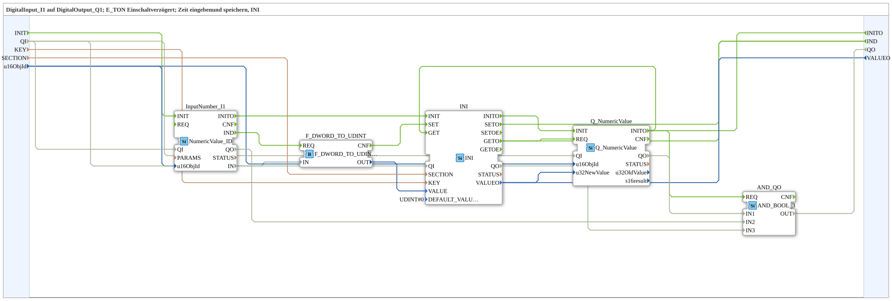

# INI_IN_AND_STORE_UDINT

* * * * * * * * * *

## Einleitung

`INI_IN_AND_STORE_UDINT` speichert einen über VT eingegebenen UDINT-Wert persistent in einer INI-Datei und lädt ihn beim Deployment automatisch wieder. Dies ist die MyLib_B-Variante der aus MyLib_AX bekannten INI-Speicherfamilie.

Allgemeines Muster siehe [INI_IN_AND_STORE / NVS_IN_AND_STORE (gemeinsames Muster)](../../MyLib_AX/sys/INI-NVS-Speicherbausteine.md).

**Quality-Anschlüsse:** Der Baustein besitzt zusätzlich den Dateneingang `QI` (BOOL, Standard `TRUE`, „Quality Input – TRUE, um den Dienst freizugeben“) und den Datenausgang `QO` (BOOL, „Quality Output – TRUE, wenn der Dienst erfolgreich ausgeführt wurde“). `QI` ist mit `Q_NumericValue.QI` und `Q_NumericValue.QO` mit `QO` verbunden.

## Zusammenfassung

UDINT-Variante der INI-Speicherfamilie (MyLib_B).

---

### 🌐 Passende Themen-Unterseiten auf ms-muc-docs.de

* [🌐 Eclipse 4diac IDE & Farb-Referenz auf ms-muc-docs.de](https://www.ms-muc-docs.de/iec-61499/eclipse-4diac/)
