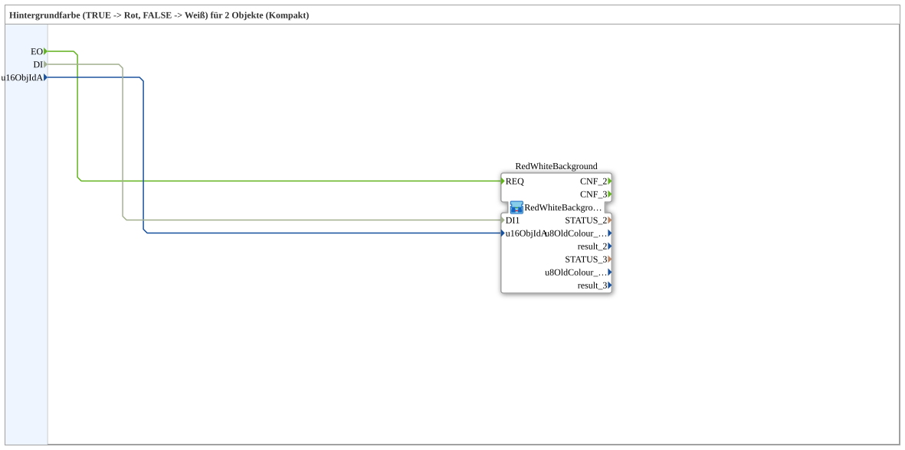

# RedWhiteBackground2C

* * * * * * * * * *

## Einleitung

`RedWhiteBackground2C` ist ein **Kompakt-Wrapper** um [`RedWhiteBackground2`](RedWhiteBackground2.md) — reicht `u16ObjId` und den Selector durch, ohne die `CNF`-Ereignisausgänge und Diagnosewerte (`STATUS_n`, `u8OldColour_n`, `result_n`) nach außen zu führen.

Details zum gemeinsamen Muster siehe [Background-Farbbausteine (gemeinsames Muster)](../../MyLib_AX/sys/Background-Farbbausteine.md).

Zusätzlich führt der Wrapper die Schnittstelle für Initialisierung und Qualität nach außen: Ereigniseingang `INIT`, Ereignisausgang `INITO`, Dateneingang `QI` (`BOOL`, Initialwert `TRUE`) und Datenausgang `QO` (`BOOL`). Sie sind 1:1 an die innere Instanz `RedWhiteBackground` durchgeschleift: `INIT` → `RedWhiteBackground.INIT`, `RedWhiteBackground.INITO` → `INITO`, `QI` → `RedWhiteBackground.QI`, `RedWhiteBackground.QO` → `QO`.

## Zusammenfassung

Reine Weiterleitung an `RedWhiteBackground2` für den Regelfall, in dem die Diagnosewerte nicht gebraucht werden.

---

### 🌐 Passende Themen-Unterseiten auf ms-muc-docs.de

* [🌐 Eclipse 4diac IDE & Farb-Referenz auf ms-muc-docs.de](https://www.ms-muc-docs.de/iec-61499/eclipse-4diac/)
