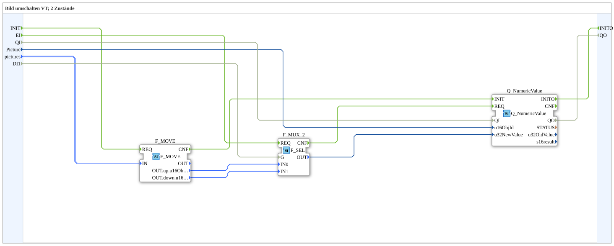

# SwitchPic_2_1

* * * * * * * * * *

## Einleitung

`SwitchPic_2_1` schaltet ein VT-Bild (Object-Pointer) zwischen 2 Zuständen (`up`/`down`) anhand eines booleschen Selectors (`DI1`) um — nur das normale VT-Objekt (`Picture`, via `Q_NumericValue`), kein AUX-Objekt.

Allgemeines Muster siehe [SwitchPic(Col)-Bausteine (gemeinsames Muster)](./SwitchPic-Bausteine.md).

## Schnittstelle (QI/QO)

Der Baustein besitzt den Dateneingang `QI` (`BOOL`, Standardwert `TRUE`, Quality Input) und den Datenausgang `QO` (`BOOL`, Quality Output). `QI` wird direkt an `Q_NumericValue.QI` und `Q_NumericValue.QO` direkt an `QO` durchgereicht.

## Zusammenfassung

Variante "1" (nur normales Objekt) der 2-Zustände-Bildumschaltung.

---

### 🌐 Passende Themen-Unterseiten auf ms-muc-docs.de

* [🌐 Eclipse 4diac IDE & Farb-Referenz auf ms-muc-docs.de](https://www.ms-muc-docs.de/iec-61499/eclipse-4diac/)
