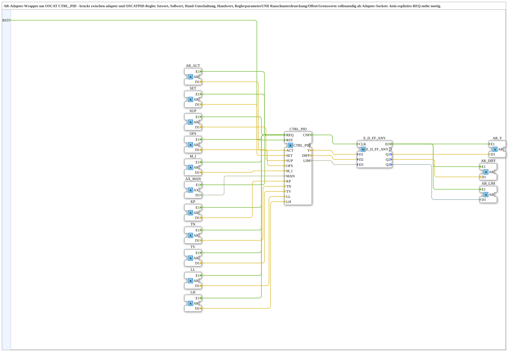
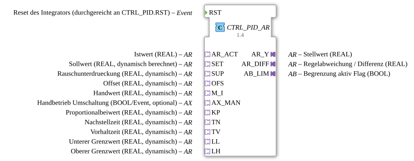

# CTRL_PID_AR

* * * * * * * * * *

## Einleitung

`CTRL_PID_AR` ist ein AR-Adapter-Wrapper um den OSCAT-PID-Regler [`CTRL_PID`](./CTRL_PID.md) (`OSCAT::Basic::POUs::Engineering::Control::CTRL_PID`) und überbrückt zwischen Adaptern und dem OSCAT-Regler. Istwert, Sollwert, Handumschaltung, Handwert, Reglerparameter sowie Rauschunterdrückung, Offset und Grenzwerte sind vollständig als Adapter-Sockets ausgeführt – in derselben Reihenfolge wie die Eingangsvariablen des umschlossenen `CTRL_PID`. Ein explizites `REQ` ist nicht nötig, da jeder Socket bei Ankunft eines neuen Werts selbst `CTRL_PID.REQ` auslöst.

## Schnittstellenstruktur

### **Ereignis-Eingänge**

- **RST**: Reset des Integrators (durchgereicht an `CTRL_PID.RST`)

### **Ereignis-Ausgänge**

*Keine direkten Ereignis-Ausgänge vorhanden – Ereignisse laufen über die Adapter-Plugs*

### **Daten-Eingänge**

*Keine Daten-Eingänge vorhanden – alle Eingänge sind Adapter-Sockets*

### **Daten-Ausgänge**

*Keine Daten-Ausgänge vorhanden – alle Ausgänge sind Adapter-Plugs*

### **Adapter**

Sockets (Eingänge), jeweils `E1` löst `CTRL_PID.REQ` aus, `D1` liefert den Wert:

- **AR_ACT** (`AR`): Istwert (REAL)
- **SET** (`AR`): Sollwert (REAL, dynamisch berechnet)
- **SUP** (`AR`): Rauschunterdrückung (REAL, dynamisch)
- **OFS** (`AR`): Offset (REAL, dynamisch)
- **M_I** (`AR`): Handwert (REAL, dynamisch)
- **AX_MAN** (`AX`): Handbetrieb-Umschaltung (BOOL/Event, optional)
- **KP** (`AR`): Proportionalbeiwert (REAL, dynamisch)
- **TN** (`AR`): Nachstellzeit (REAL, dynamisch)
- **TV** (`AR`): Vorhaltzeit (REAL, dynamisch)
- **LL** (`AR`): Unterer Grenzwert (REAL, dynamisch)
- **LH** (`AR`): Oberer Grenzwert (REAL, dynamisch)

Plugs (Ausgänge):

- **AR_Y** (`AR`): Stellwert (REAL)
- **AR_DIFF** (`AR`): Regelabweichung (`DIFF = SET - ACT`, REAL)
- **AB_LIM** (`AB`): Begrenzung-aktiv-Flag (`LIM`, BOOL)

## Verwendete Funktionsbausteine (FBs)

- **CTRL_PID**: [`OSCAT::Basic::POUs::Engineering::Control::CTRL_PID`](./CTRL_PID.md)
- **E_D_FF_ANY**: `iec61499::events::E_D_FF_ANY_3` – 3-fach-Datenlatch für `Y`, `DIFF`, `LIM`

## Programmablauf und Verbindungen

1. Jedes `E1` der Sockets `AR_ACT`, `SET`, `SUP`, `OFS`, `M_I`, `AX_MAN`, `KP`, `TN`, `TV`, `LL`, `LH` → `CTRL_PID.REQ`.
2. `D1` der Sockets → gleichnamiger Eingang von `CTRL_PID` (`AR_ACT.D1` → `ACT`, `AX_MAN.D1` → `MAN`, sonst gleiche Namen).
3. `RST` → `CTRL_PID.RST`.
4. `CTRL_PID.CNF` → `E_D_FF_ANY.CLK`; `CTRL_PID.Y`/`DIFF`/`LIM` → `E_D_FF_ANY.D1`/`D2`/`D3`.
5. `E_D_FF_ANY.EO` → `AR_Y.E1`, `AR_DIFF.E1`, `AB_LIM.E1`; `Q1`/`Q2`/`Q3` → `AR_Y.D1`, `AR_DIFF.D1`, `AB_LIM.D1`.

## Technische Besonderheiten

- Der Latch (`E_D_FF_ANY`) löst die Ausgänge erst nach dem `CNF` des Reglers aus; es gibt kein externes `CNF`-Ereignis mehr.
- Jeder Eingangs-Socket löst eine Berechnung aus; bei mehreren gleichzeitig geänderten Werten erfolgt daher mehrfaches `REQ`.
- Die Sockets sind in der Reihenfolge der `InputVars` von `CTRL_PID` sortiert (Version 1.4).

## Anwendungsszenarien

- PID-Regelung in Adapter-Netzwerken, z. B. Geschwindigkeitsregelung der Aufnahme mit dynamisch berechnetem Sollwert und `AX_MAN` aus einem Automatik/Hand-Umschalter

## 🛠️ Zugehörige Übungen

- [Uebung_153_AX](https://meisterschulen-am-ostbahnhof-munchen-docs.readthedocs.io/projects/4diac-exercises-docs/de/latest/Uebungen/test_AX/Uebungen_doc/Uebung_153_AX/)

## Fazit

`CTRL_PID_AR` bindet den OSCAT-PID-Regler vollständig über AR-/AX-Adapter an, sodass Werte nur noch über Adapter-Verbindungen fließen und kein explizites `REQ` nötig ist.
