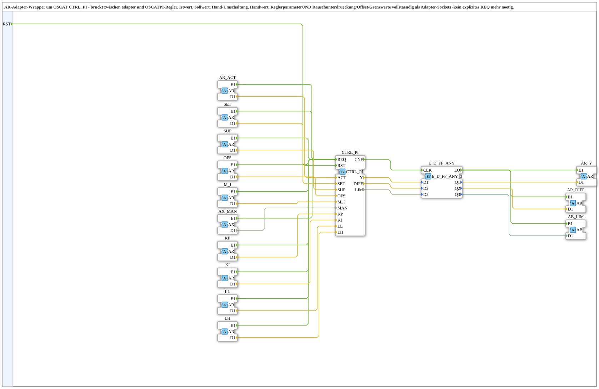
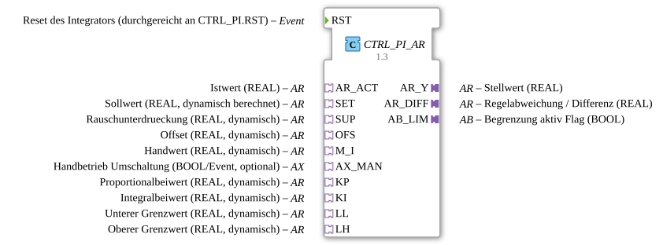

# CTRL_PI_AR

* * * * * * * * * *

## Einleitung

`CTRL_PI_AR` ist ein AR-Adapter-Wrapper um den OSCAT-PI-Regler `OSCAT::Basic::POUs::Engineering::Control::CTRL_PI`. Er überbrückt zwischen Adaptern und OSCAT, ohne dass eine der beiden Basisbibliotheken von der anderen abhängt. Istwert, Sollwert, Rauschunterdrückung, Offset, Handwert, Handbetrieb-Umschaltung, Reglerparameter und Grenzwerte sind vollständig als Adapter-Sockets ausgeführt; ein explizites `REQ` ist nicht mehr nötig, weil jeder Socket den Regler selbst auslöst.

## Schnittstellenstruktur

### **Ereignis-Eingänge**

- **RST**: Reset des Integrators (durchgereicht an `CTRL_PI.RST`)

### **Ereignis-Ausgänge**

Der Funktionsblock verfügt über keine direkten Ereignis-Ausgänge.

### **Daten-Eingänge**

Der Funktionsblock verfügt über keine direkten Daten-Eingänge.

### **Daten-Ausgänge**

Der Funktionsblock verfügt über keine direkten Daten-Ausgänge.

### **Adapter**

- **AR_ACT** (Socket, `AR`): Istwert (REAL)
- **SET** (Socket, `AR`): Sollwert (REAL, dynamisch berechnet)
- **SUP** (Socket, `AR`): Rauschunterdrückung (REAL, dynamisch)
- **OFS** (Socket, `AR`): Offset (REAL, dynamisch)
- **M_I** (Socket, `AR`): Handwert (REAL, dynamisch)
- **AX_MAN** (Socket, `AX`): Umschaltung auf Handbetrieb (optional)
- **KP** (Socket, `AR`): Proportionalbeiwert (REAL, dynamisch)
- **KI** (Socket, `AR`): Integralbeiwert (REAL, dynamisch)
- **LL** (Socket, `AR`): unterer Grenzwert (REAL, dynamisch)
- **LH** (Socket, `AR`): oberer Grenzwert (REAL, dynamisch)
- **AR_Y** (Plug, `AR`): Stellwert (REAL)
- **AR_DIFF** (Plug, `AR`): Regelabweichung `DIFF = SET - ACT` (REAL)
- **AB_LIM** (Plug, `AB`): Flag 'Begrenzung aktiv' (BOOL)

## Funktionsweise

Das Netzwerk besteht aus dem Regler `CTRL_PI` (`OSCAT::Basic::POUs::Engineering::Control::CTRL_PI`) und einem Änderungsfilter `E_D_FF_ANY` ([`iec61499::events::E_D_FF_ANY_3`](../../../../../../StandardLibraries/events/E_D_FF_ANY_3.md)):

- **Auslösen**: Das Ereignis `E1` jedes Sockets (`AR_ACT`, `SET`, `SUP`, `OFS`, `M_I`, `AX_MAN`, `KP`, `KI`, `LL`, `LH`) führt auf `CTRL_PI.REQ`. `RST` führt auf `CTRL_PI.RST`.
- **Daten**: `AR_ACT.D1` → `ACT`, `SET.D1` → `SET`, `SUP.D1` → `SUP`, `OFS.D1` → `OFS`, `M_I.D1` → `M_I`, `AX_MAN.D1` → `MAN`, `KP.D1` → `KP`, `KI.D1` → `KI`, `LL.D1` → `LL`, `LH.D1` → `LH` des Reglers.
- **Ausgabe**: `CTRL_PI.CNF` → `E_D_FF_ANY.CLK`; `CTRL_PI.Y`, `CTRL_PI.DIFF` und `CTRL_PI.LIM` gehen auf `E_D_FF_ANY.D1`..`D3`. Nur wenn sich mindestens einer der drei Werte ändert, gibt `E_D_FF_ANY.EO` das Ereignis auf `AR_Y.E1`, `AR_DIFF.E1` und `AB_LIM.E1`, und `Q1`..`Q3` gehen auf `AR_Y.D1`, `AR_DIFF.D1` und `AB_LIM.D1`.

## Technische Besonderheiten

- Das Ereignis `CNF` des Reglers ist nur noch intern (für das Latch von `Y`/`DIFF`/`LIM`); ein externes `REQ`/`CNF` gibt es nicht mehr
- Jeder Socket löst den Regler aus, sodass bei mehreren gleichzeitig eintreffenden Werten mehrere Regler-Durchläufe möglich sind
- Die Sockets sind in der Reihenfolge der InputVars von `CTRL_PI` sortiert: `AR_ACT`, `SET`, `SUP`, `OFS`, `M_I`, `AX_MAN`, `KP`, `KI`, `LL`, `LH`
- Die Adapter-Brücke liegt in der Bibliothek `OSCAT_adapter`, die von `adapter` und `OSCAT` abhängt; so müssen diese beiden nicht voneinander abhängen

## Anwendungsszenarien

- PI-Regelung in rein adapterbasierten Netzwerken, z. B. Geschwindigkeits- oder Drehzahlregelung mit dynamisch berechnetem Sollwert
- Regler, deren Parameter (KP, KI) und Grenzen zur Laufzeit per VT/OPC-UA veränderbar sind

## 🛠️ Zugehörige Übungen

- [Uebung_152_AX](https://meisterschulen-am-ostbahnhof-munchen-docs.readthedocs.io/projects/4diac-exercises-docs/de/latest/Uebungen/test_AX/Uebungen_doc/Uebung_152_AX/)

## Fazit

`CTRL_PI_AR` macht den OSCAT-PI-Regler adapterfähig: Alle Ein- und Ausgänge sind AR-/AX-/AB-Adapter, jeder Eingang löst die Berechnung aus, und Ergebnisse werden nur bei Änderung ausgegeben.
