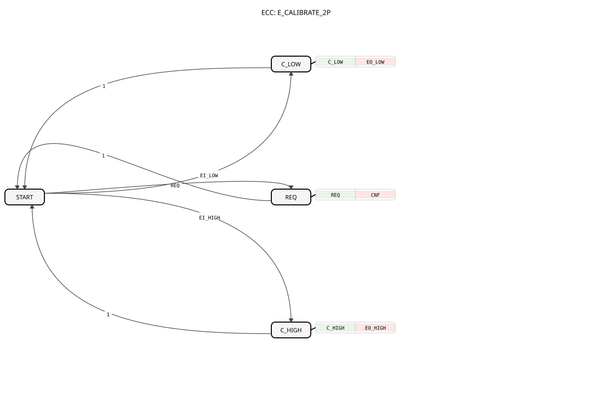

# E_CALIBRATE_2P




* * * * * * * * * *

## Einleitung

`E_CALIBRATE_2P` ist eine ereignisgesteuerte Zwei-Punkt-Kalibrierung (Low/High) mit unabhängig gespeicherten Punkten. Er ersetzt [E_CALIBRATE](E_CALIBRATE.md) (`E_CALIBRATE_SQ`-Verhalten): Die beiden Punkte werden vollkommen unabhängig voneinander gespeichert und erst beim Lesen (`REQ`) zu einer Geraden kombiniert. Es gibt daher keine erzwungene Reihenfolge `EI_LOW`/`EI_HIGH`.

## Schnittstellenstruktur

### **Ereignis-Eingänge**

- **REQ**: Normale Ausführungsanforderung, berechnet `Y`. Liefert `X`, `LOW_REF`, `HIGH_REF`, `X_LOW`, `X_HIGH`.
- **EI_LOW**: Kalibriert den unteren Punkt (`X_LOW := X`). Liefert `X`.
- **EI_HIGH**: Kalibriert den oberen Punkt (`X_HIGH := X`). Liefert `X`.

### **Ereignis-Ausgänge**

- **CNF**: Bestätigt `REQ`, liefert `Y`.
- **EO_LOW**: Unterer Punkt kalibriert, liefert `X_LOW`.
- **EO_HIGH**: Oberer Punkt kalibriert, liefert `X_HIGH`.

### **Daten-Eingänge**

- **X** (REAL): Roheingangswert.
- **LOW_REF** (REAL): Zielausgabewert `Y` am unteren Kalibrierpunkt.
- **HIGH_REF** (REAL): Zielausgabewert `Y` am oberen Kalibrierpunkt.

### **Daten-Ausgänge**

- **Y** (REAL): Kalibrierter Ausgangswert.

### **Ein-/Ausgabevariablen (InOut)**

- **X_LOW** (REAL, Startwert `0.0`): Gespeicherter Rohwert am unteren Kalibrierpunkt.
- **X_HIGH** (REAL, Startwert `1.0`): Gespeicherter Rohwert am oberen Kalibrierpunkt.

### **Adapter**

Keine Adapter vorhanden.

## Funktionsweise

Formel: `Y = LOW_REF + (X - X_LOW) * (HIGH_REF - LOW_REF) / (X_HIGH - X_LOW)`

Der Baustein besitzt einen Startzustand `START` sowie drei direkt daraus erreichbare Aktionszustände:

- **REQ**: Berechnet `Y` live per linearer Interpolation zwischen den beiden gespeicherten Punkten (ohne Begrenzung, wie bei `E_CALIBRATE_SQ`) und feuert `CNF`. Ist `X_HIGH - X_LOW = 0`, gilt `Y := LOW_REF`.
- **C_LOW**: Speichert den aktuellen Rohwert in `X_LOW` und feuert `EO_LOW`.
- **C_HIGH**: Speichert den aktuellen Rohwert in `X_HIGH` und feuert `EO_HIGH`.

Jeder Aktionszustand kehrt sofort zu `START` zurück.

**Kalibrierung (beliebige Reihenfolge):**

1. **Low (`EI_LOW`)**: Unteren Referenzwert anlegen, `LOW_REF` auf den gewünschten Ausgang setzen, `EI_LOW` auslösen → `X_LOW := X`
2. **High (`EI_HIGH`)**: Oberen Referenzwert anlegen, `HIGH_REF` auf den gewünschten Ausgang setzen, `EI_HIGH` auslösen → `X_HIGH := X`

Jeder Punkt kann später einzeln neu kalibriert werden, ohne den anderen zu wiederholen.

## Technische Besonderheiten

- **Unabhängige Punkte statt inkrementeller OFFSET/SCALE-Berechnung:** `E_CALIBRATE_SQ` berechnet OFFSET/SCALE schrittweise (EICO setzt OFFSET aus einem aktuellen SCALE, EICS berechnet beide aus intern gemerkten Werten) und ist erst nach mindestens einem EICO mathematisch gültig. Das erforderte eine per ECC erzwungene Reihenfolge, um stillschweigend falsche Offsets zu vermeiden. `E_CALIBRATE_2P` speichert `X_LOW`/`X_HIGH` wie `E_CALIBRATE_3P` seine Punkte, ohne Datenabhängigkeit zwischen `EI_LOW` und `EI_HIGH`.
- Keine Begrenzung von `Y` auf `LOW_REF..HIGH_REF` (anders als `E_CALIBRATE_3P`).
- Entartete Kalibrierpunkte (`X_HIGH = X_LOW`) liefern `LOW_REF` statt einer Division durch Null.

## Zustandsübersicht

```text
START --REQ-----> REQ    --1--> START   (Normalbetrieb)
START --EI_LOW--> C_LOW  --1--> START   (unteren Punkt kalibrieren)
START --EI_HIGH-> C_HIGH --1--> START   (oberen Punkt kalibrieren)
```

## Anwendungsszenarien

- Zwei-Punkt-Kalibrierung von Analogeingängen (z. B. Sensoren), wenn die Kalibrierauslösung bereits als Ereignis vorliegt
- Nachjustage nur eines Punktes

## ⚖️ Vergleich mit ähnlichen Bausteinen

- [E_CALIBRATE](E_CALIBRATE.md): Variante mit `EICO`/`EICS` (`OFFSET`/`SCALE`), bei der `EICS` nur nach `EICO` ein konsistentes Ergebnis liefert
- [E_CALIBRATE_3P](E_CALIBRATE_3P.md): Drei-Punkt-Variante mit stückweiser Interpolation und Begrenzung

## Fazit

`E_CALIBRATE_2P` bietet eine ereignisgesteuerte Zwei-Punkt-Kalibrierung mit unabhängig ansteuerbaren Kalibrierpunkten und ohne erzwungene Reihenfolge.
