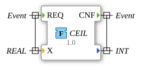

# CEIL

* * * * * * * * * *

## Einleitung

Die Funktion `CEIL` ist eine Rundungsfunktion (portiert aus `OSCAT_basic`, `CEIL.TcPOU`), die die kleinste ganze Zahl zurückgibt, die größer oder gleich `X` ist. Das Ergebnis wird auf den `INT`-Bereich begrenzt.

## Schnittstellenstruktur

### **Ereignis-Eingänge**

- `REQ`: Startet die Berechnung. Verbundene Daten: `X`

### **Ereignis-Ausgänge**

- `CNF`: Signalisiert die Berechnung und die Ausgabe des Ergebnisses.

### **Daten-Eingänge**

- `X` (`REAL`): Zu rundender Wert

### **Daten-Ausgänge**

- (kein Name) (`INT`): Aufgerundeter Wert, zugleich der Rückgabewert der Funktion

### **Adapter**

Diese Funktion verwendet keine Adapter.

## Funktionsweise

1. Ist `X >= 32767.0`, ist das Ergebnis `32767`.
2. Ist `X <= -32768.0`, ist das Ergebnis `-32768`.
3. Andernfalls wird `X` mit `REAL_TO_INT` in eine ganze Zahl umgewandelt. Ist das Ergebnis kleiner als `X`, wird 1 addiert.

Beispiele: `CEIL(3.14) = 4`, `CEIL(-3.14) = -3`.

## Technische Besonderheiten

- Implementierung in Structured Text (ST) als `FUNCTION` ohne internen Zustand
- Teil des Pakets `OSCAT::Basic::POUs::Mathematical`
- Die Bereichsprüfung schützt vor einem `INT`-Überlauf (Portierung vom 2026-09-17).
- `REAL_TO_INT` wird statt `TRUNC` verwendet (Kompatibilität, Revision 1.1 des OSCAT-Originals).

## Anwendungsszenarien

- Aufrunden von Zahlenwerten, z. B. für Anzeige- oder Zählwerte

## Fazit

`CEIL` liefert die nächstgrößere ganze Zahl zu einem `REAL`-Wert als `INT` und begrenzt das Ergebnis auf den `INT`-Wertebereich.
