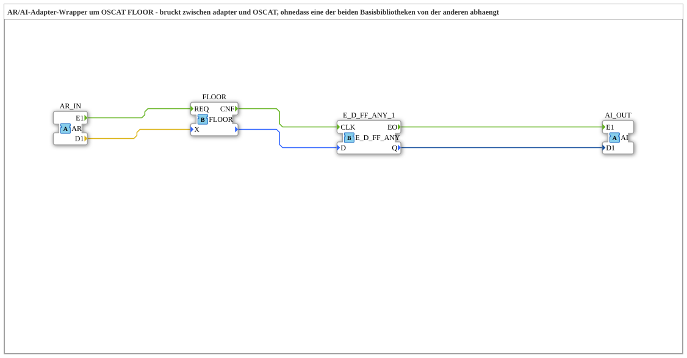

# FLOOR_AR

* * * * * * * * * *

## Einleitung

`FLOOR_AR` ist ein Adapter-Wrapper um `OSCAT::Basic::POUs::Mathematical::FLOOR`. Er verbindet den `AR`-Adapter mit der OSCAT-Funktion `FLOOR` und gibt das Ergebnis als `AI`-Adapter aus (größte ganze Zahl kleiner oder gleich X (INT)). Der Wrapper überbrückt Adapter- und OSCAT-Bibliothek, ohne dass eine der beiden Basisbibliotheken von der anderen abhängt.

## Schnittstellenstruktur

### **Ereignis-Eingänge**

Keine direkten Ereignis-Eingänge – Ereignisse kommen über den Adapter `AR_IN`.

### **Ereignis-Ausgänge**

Keine direkten Ereignis-Ausgänge – Ereignisse gehen über den Adapter `AI_OUT`.

### **Daten-Eingänge**

Keine.

### **Daten-Ausgänge**

Keine.

### **Adapter**

- **AR_IN** (Socket, `adapter::types::unidirectional::AR`): Eingangssignal (`REAL`)
- **AI_OUT** (Plug, `adapter::types::unidirectional::AI`): größte ganze Zahl kleiner oder gleich X (INT)

## Verwendete Funktionsbausteine (FBs)

- **`FLOOR`** (`OSCAT::Basic::POUs::Mathematical::FLOOR`): Rundungsfunktion, siehe [FLOOR](./FLOOR.md)
- **`E_D_FF_ANY_1`** (`iec61499::events::E_D_FF_ANY`): Änderungsfilter

## Funktionsweise

- `AR_IN.E1` → `FLOOR.REQ`; `AR_IN.D1` → `FLOOR.X`
- `FLOOR.CNF` → `E_D_FF_ANY_1.CLK`; Rückgabewert von `FLOOR` → `E_D_FF_ANY_1.D`
- `E_D_FF_ANY_1.EO` → `AI_OUT.E1`; `E_D_FF_ANY_1.Q` → `AI_OUT.D1`

## Technische Besonderheiten

- `E_D_FF_ANY_1` (Standardbibliothek `events-3.0.0`) filtert Änderungen: `AI_OUT.E1` feuert nur, wenn sich das Ergebnis seit dem letzten Aufruf tatsächlich geändert hat. Gleiches Muster wie bei den Wrappern `FT_DERIV_AR`/`CTRL_PI_AR`.
- **Warum ein eigener Wrapper?** `FLOOR` ist eine reine OSCAT-`Function` ohne Adapter-Schnittstelle. `adapter` soll nicht von `OSCAT` abhängen (und umgekehrt); die Brücke liegt daher im dritten Bibliotheksprojekt `OSCAT_adapter`, das von beiden abhängt.

## Anwendungsszenarien

- Runden eines `AR`-Signals in einer Adapter-Kette auf eine ganze Zahl (`INT`)

## Zusammenfassung

`FLOOR_AR` rundet einen `AR`-Wert mit `FLOOR` und gibt das Ergebnis nur bei Änderung als `AI`-Adapter aus.
