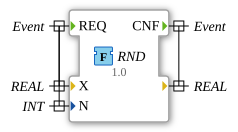

# RND

* * * * * * * * * *

## Einleitung

Die Funktion `RND` rundet eine `REAL`-Zahl auf `N` **signifikante** Stellen (nicht auf Nachkommastellen). Sie ist aus `OSCAT_basic` portiert. Anders als [`ROUND`](ROUND.md) bezeichnet `N` hier die Gesamtzahl der signifikanten Stellen.

## Schnittstellenstruktur

### **Ereignis-Eingänge**

- **REQ**: Startet die Berechnung. Verbundene Daten: `X`, `N`.

### **Ereignis-Ausgänge**

- **CNF**: Signalisiert die Berechnung und die Ausgabe des Ergebnisses.

### **Daten-Eingänge**

- **X** (`REAL`): Zu rundender Wert
- **N** (`INT`): Anzahl der signifikanten Stellen

### **Daten-Ausgänge**

- **(unbenannt)** (`REAL`): Gerundeter Wert, zugleich Rückgabewert der Funktion

### **Adapter**

Diese Funktion verwendet keine Adapter.

## Funktionsweise

1. Ist `X = 0.0`, ist das Ergebnis `0.0`.
2. Andernfalls wird der Faktor `M = 10^(LIMIT(1, N, 8) - CEIL(LOG(ABS(X))))` berechnet; der Exponent wird auf `-37..8` begrenzt.
3. Ist `ABS(X * M) >= 2147483647.0`, wird `X` unverändert zurückgegeben (Schutz vor `DINT`-Überlauf).
4. Sonst ist das Ergebnis `DINT_TO_REAL(REAL_TO_DINT(X * M)) / M`.

## Technische Besonderheiten

- Implementierung in Structured Text (ST) als `FUNCTION` ohne internen Zustand, Paket `OSCAT::Basic::POUs::Mathematical`
- `N` wird auf `1..8` begrenzt
- Portierung vom 2026-09-17: Begrenzung von `N` (1..8), des Exponenten (-37..8) und eine Bereichsprüfung schützen vor `DINT`-Überlauf
- Originalversion 1.1 (4. Apr. 2008, hm): Typumwandlung ergänzt, um Warnungen unter CODESYS 3.0 zu vermeiden

## Anwendungsszenarien

- Runden von Messwerten auf eine feste Anzahl signifikanter Stellen, unabhängig von der Größenordnung

## ⚖️ Vergleich mit ähnlichen Bausteinen

- [`ROUND`](ROUND.md) rundet auf `N` Nachkommastellen, `RND` auf `N` signifikante Stellen.

## Fazit

`RND` rundet eine `REAL`-Zahl auf `N` signifikante Stellen und schützt dabei vor `DINT`-Überlauf.
