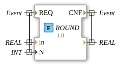

# ROUND

* * * * * * * * * *

## Einleitung

Die Funktion `ROUND` rundet einen `REAL`-Wert auf `N` Nachkommastellen (0 bis 8). Sie wurde aus `OSCAT_basic` portiert.

## Schnittstellenstruktur

### **Ereignis-Eingänge**

- `REQ`: Startet die Berechnung. Verbundene Daten: `in`, `N`

### **Ereignis-Ausgänge**

- `CNF`: Signalisiert die Berechnung und die Ausgabe des Ergebnisses.

### **Daten-Eingänge**

- `in` (`REAL`): Zu rundender Wert
- `N` (`INT`): Anzahl der Nachkommastellen (wird auf 0 bis 8 begrenzt)

### **Daten-Ausgänge**

- (kein Name) (`REAL`): Gerundeter Wert, zugleich der Rückgabewert der Funktion

### **Adapter**

Diese Funktion verwendet keine Adapter.

## Funktionsweise

1. Der Faktor `X := EXPT(10.0, LIMIT(0, N, 8))` wird bestimmt.
2. Ist `ABS(in * X) >= 2147483647.0` (DINT-Bereich), wird `in` unverändert zurückgegeben.
3. Andernfalls ist das Ergebnis `DINT_TO_REAL(REAL_TO_DINT(in * X)) / X`.

## Technische Besonderheiten

- Implementierung in Structured Text (ST) als `FUNCTION` mit lokaler Variable `X`, ohne internen Zustand
- Teil des Pakets `OSCAT::Basic::POUs::Mathematical`
- `EXPT(10.0, LIMIT(0, N, 8))` ersetzt die globalen OSCAT-Konstanten `decades`; die Bereichsprüfung schützt vor einem `DINT`-Überlauf (Portierung vom 2026-09-17).
- `REAL_TO_DINT` statt `TRUNC` korrigiert den Fehler bei negativen Zahlen (OSCAT-Revision 1.3).
- `N` wird auf 0 bis 8 begrenzt.

## Anwendungsszenarien

- Runden von Messwerten für Anzeige oder Vergleich auf eine feste Anzahl Nachkommastellen

## Fazit

`ROUND` rundet einen `REAL`-Wert auf bis zu 8 Nachkommastellen und gibt bei zu großen Werten den Eingang unverändert zurück.
