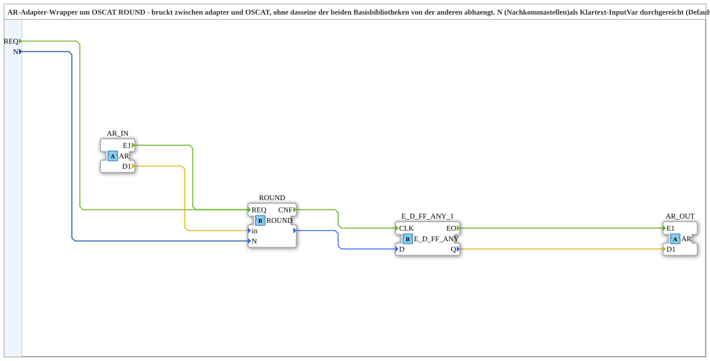

# ROUND_AR

* * * * * * * * * *

## Einleitung

`ROUND_AR` ist ein AR-Adapter-Wrapper um die OSCAT-Funktion `OSCAT::Basic::POUs::Mathematical::ROUND` (rundet `in` auf `N` Nachkommastellen, 0 bis 8 Stellen). Er überbrückt zwischen Adaptern und OSCAT, ohne dass eine der beiden Basisbibliotheken von der anderen abhängt. `N` wird als einfache Eingangsvariable (Default 2) durchgereicht.

## Schnittstellenstruktur

### **Ereignis-Eingänge**

- **REQ**: explizite Ausführungsanforderung (durchgereicht an `ROUND.REQ`, zusätzlich zu `AR_IN.E1`)
    - **Verbundene Daten**: `N`

### **Ereignis-Ausgänge**

Der Funktionsblock verfügt über keine direkten Ereignis-Ausgänge.

### **Daten-Eingänge**

- **N** (INT): Anzahl der Nachkommastellen (durchgereicht an `ROUND.N`); Platzhalter-Default 2, per Parameter überschreibbar

### **Daten-Ausgänge**

Der Funktionsblock verfügt über keine direkten Daten-Ausgänge.

### **Adapter**

- **AR_IN** (Socket, `adapter::types::unidirectional::AR`): Eingangssignal (REAL)
- **AR_OUT** (Plug, `adapter::types::unidirectional::AR`): auf `N` Nachkommastellen gerundeter Wert (REAL)

## Funktionsweise

- `AR_IN.E1` → `ROUND.REQ` und `AR_IN.D1` → `ROUND.in`; `N` → `ROUND.N`.
- `REQ` führt ebenfalls auf `ROUND.REQ`, parallel zu `AR_IN.E1`.
- `ROUND.CNF` → `E_D_FF_ANY_1.CLK`; das Funktionsergebnis geht an `E_D_FF_ANY_1.D`.
- `E_D_FF_ANY_1` ([`iec61499::events::E_D_FF_ANY`](../../../../../StandardLibraries/events/E_D_FF_ANY.md)) filtert Änderungen: `E_D_FF_ANY_1.EO` → `AR_OUT.E1` und `E_D_FF_ANY_1.Q` → `AR_OUT.D1`, aber nur, wenn sich das gerundete Ergebnis seit dem letzten Aufruf tatsächlich geändert hat.

## Technische Besonderheiten

- Das explizite `REQ` mit `With N` wurde ergänzt, weil `N` sonst nur per Datenverbindung ausgelesen würde; nach IEC 61499 werden nicht über `With` gebundene Variablen nicht zuverlässig gelesen. `REQ` erlaubt manuellen oder periodischen Aufruf zusätzlich zum automatischen Auslösen über `AR_IN.E1`
- Änderungsfilter: `AR_OUT.E1` feuert nur bei tatsächlicher Änderung des gerundeten Werts (gleiches Muster wie bei `CTRL_PI_AR`/`FT_DERIV_AR`, dort mit `E_D_FF_ANY_3`/`_4`)
- `ROUND` ist eine reine OSCAT-Funktion ohne Adapter-Schnittstelle; die Brücke liegt im dritten Bibliotheksprojekt `OSCAT_adapter`

## Anwendungsszenarien

- Runden angezeigter oder weitergegebener Messwerte auf eine feste Anzahl Nachkommastellen in Adapter-Netzwerken

## ⚖️ Vergleich mit ähnlichen Bausteinen

`ROUND_STEP_AR` rundet auf ein beliebiges Raster (z. B. 0.25) statt nur auf Nachkommastellen und verwendet intern `ROUND_AR` (`ROUND(AR_IN / RASTER) * RASTER`). [`FLOOR2_AR`](FLOOR2_AR.md) liefert dagegen eine abgerundete ganze Zahl als DINT.

## Fazit

`ROUND_AR` stellt `ROUND` als Adapter-Baustein von `AR` nach `AR` bereit, rundet auf `N` Nachkommastellen und gibt das Ergebnis nur bei Änderung aus.
