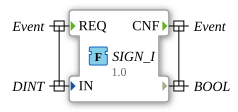

# SIGN_I

this function return true if the integer input is negative

## Interface

### Event Inputs

| Name | Comment | With |
| :--- | :------ | :--- |
| REQ  |         | IN   |

### Event Outputs

| Name | Comment | With |
| :--- | :------ | :--- |
| CNF  |         |      |

### Input Vars

| Name | Type | Comment |
| :--- | :--- | :------ |
| IN   | DINT |         |

### Output Vars

| Name | Type | Comment |
| :--- | :--- | :------ |
|      | BOOL |         |
