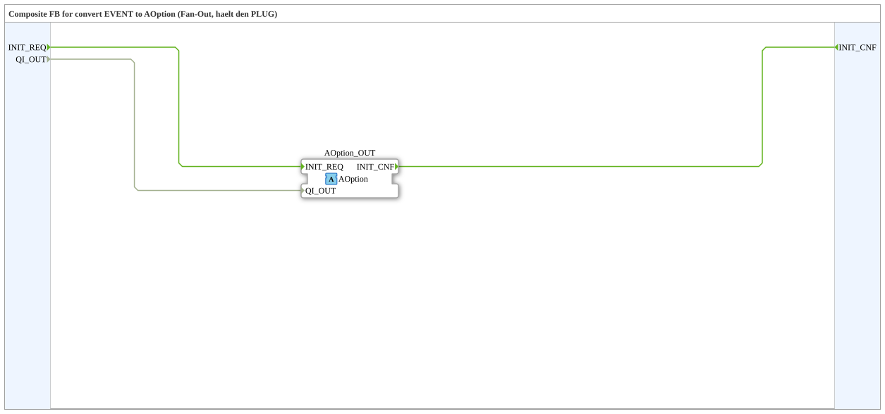

# AOption_EVENT_TO_X

* * * * * * * * * *

## Einleitung

`AOption_EVENT_TO_X` ist ein Composite-FB, der Ereignisse und Daten auf den Options-Adapter [`AOption`](../AOption.md) abbildet (Fan-Out, hält den PLUG).

## Schnittstellenstruktur

### **Ereignis-Eingänge**

| Ereignis | Typ | Kommentar |
|----------|-----|-----------|
| `INIT_REQ` | EInit | Anforderung an den Adapter. Trägt die Daten `QI_OUT`. |

### **Ereignis-Ausgänge**

| Ereignis | Typ | Kommentar |
|----------|-----|-----------|
| `INIT_CNF` | EInit | Bestätigung vom Adapter. |

### **Daten-Eingänge**

| Variable | Typ | Kommentar |
|----------|-----|-----------|
| `QI_OUT` | BOOL | Event Input Qualifier (IEC 61499-1): `TRUE` = Option anfordern/aktivieren, `FALSE` = zurückziehen. |

### **Daten-Ausgänge**

Keine vorhanden.

### **Adapter**

| Adapter | Typ | Richtung | Kommentar |
|---------|-----|----------|-----------|
| `AOption_OUT` | `Option::AOption` | Plug | Adapter-Ausgang. |

## Funktionsweise

Das interne Netzwerk besteht nur aus Verbindungen (keine weiteren FBs):

- `INIT_REQ` -> `AOption_OUT.INIT_REQ`
- `AOption_OUT.INIT_CNF` -> `INIT_CNF`
- `QI_OUT` -> `AOption_OUT.QI_OUT`

Eine Anforderung wird also unverändert an den Adapter weitergereicht, die Bestätigung des Sockets kommt als `INIT_CNF` zurück.

## Technische Besonderheiten

- Reines Durchreichen ohne Logik.
- Gegenstück ist [`AOption_X_TO_EVENT`](./AOption_X_TO_EVENT.md), der den SOCKET hält.

## Anwendungsszenarien

- Ein Anforderer-Netzwerk stellt über diesen Baustein eine Option bei einer Optionsgruppe ein.

## Fazit

`AOption_EVENT_TO_X` macht den Plug des `AOption`-Adapters als normale Ereignis-/Datenschnittstelle (`INIT_REQ`, `QI_OUT`, `INIT_CNF`) zugänglich.
