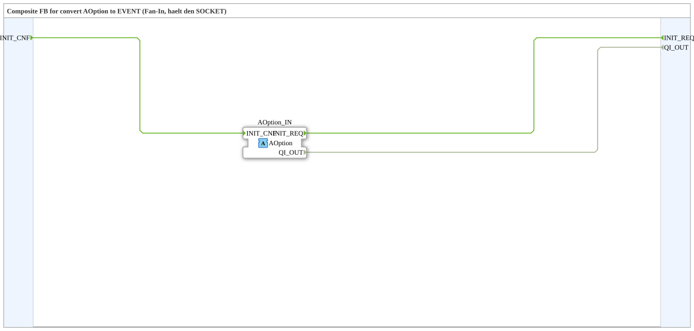

# AOption_X_TO_EVENT

* * * * * * * * * *

## Einleitung

`AOption_X_TO_EVENT` ist ein Composite-FB, der den Options-Adapter [`AOption`](../AOption.md) in Ereignisse und Daten umsetzt (Fan-In, hält den SOCKET). Er wird in Optionsgruppen eingesetzt, um die Anforderung (`INIT_REQ`, `QI_OUT`) zu empfangen und zu quittieren.

## Schnittstellenstruktur

### **Ereignis-Eingänge**

| Ereignis | Typ | Kommentar |
|----------|-----|-----------|
| `INIT_CNF` | EInit | Bestätigung an den Adapter. |

### **Ereignis-Ausgänge**

| Ereignis | Typ | Kommentar |
|----------|-----|-----------|
| `INIT_REQ` | EInit | Anforderung vom Adapter. Trägt die Daten `QI_OUT`. |

### **Daten-Eingänge**

Keine vorhanden.

### **Daten-Ausgänge**

| Variable | Typ | Kommentar |
|----------|-----|-----------|
| `QI_OUT` | BOOL | Event Input Qualifier (IEC 61499-1): `TRUE` = Option anfordern/aktivieren, `FALSE` = zurückziehen. |

### **Adapter**

| Adapter | Typ | Richtung | Kommentar |
|---------|-----|----------|-----------|
| `AOption_IN` | `Option::AOption` | Socket | Adapter-Eingang. |

## Funktionsweise

Das interne Netzwerk besteht nur aus Verbindungen (keine weiteren FBs):

- `AOption_IN.INIT_REQ` -> `INIT_REQ`
- `INIT_CNF` -> `AOption_IN.INIT_CNF`
- `AOption_IN.QI_OUT` -> `QI_OUT`

Die Anforderung des Plugs erscheint als Ereignis `INIT_REQ` mit `QI_OUT`; sobald die Gruppe initialisiert ist, wird `INIT_CNF` an den Baustein gegeben und zum Plug zurückgemeldet.

## Technische Besonderheiten

- Reines Durchreichen ohne Logik.
- Gegenstück ist [`AOption_EVENT_TO_X`](./AOption_EVENT_TO_X.md), der den PLUG hält.
- Die SubApps [`OptionalGroup_001`](../../MyLib_AX_Option/sys/OptionalGroup_001.md) und [`DummyGroup`](../../MyLib_AX_Option/sys/DummyGroup.md) verwenden ihn.

## Anwendungsszenarien

- Optionsgruppe: `QI_OUT` aktiviert/deaktiviert die Gruppe, `INIT_CNF` quittiert die Aktivierung.

## Fazit

`AOption_X_TO_EVENT` macht den Socket des `AOption`-Adapters als normale Ereignis-/Datenschnittstelle (`INIT_REQ`, `QI_OUT`, `INIT_CNF`) zugänglich.
