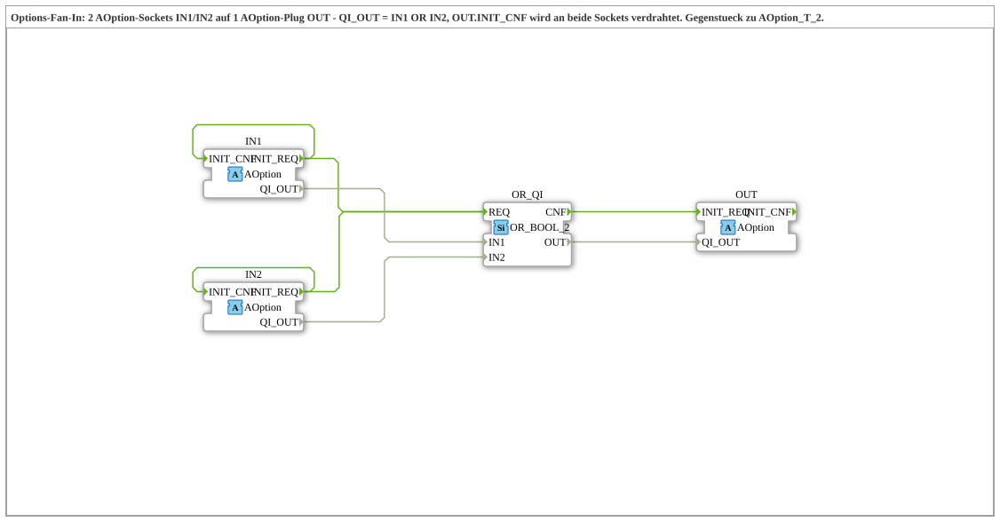

# AOption_OR_2

* * * * * * * * * *

## Einleitung

`AOption_OR_2` ist ein Composite-FB, der als **Fan-In** (ODER-Verknüpfung) für den Options-Adapter [`AOption`](../AOption.md) dient: Zwei Optionsanforderungen an den Sockets `IN1` und `IN2` werden zu einer einzigen Anforderung am Plug `OUT` zusammengeführt. `OUT` ist aktiv, solange `IN1` **oder** `IN2` aktiv ist. Der Baustein ist das Gegenstück zu [`AOption_T_2`](../splitting/AOption_T_2.md).

## Schnittstellenstruktur

### **Ereignis-Eingänge**

Keine vorhanden (die Ereignisse laufen über die Adapter).

### **Ereignis-Ausgänge**

Keine vorhanden.

### **Daten-Eingänge**

Keine vorhanden.

### **Daten-Ausgänge**

Keine vorhanden.

### **Adapter**

| Adapter | Typ | Richtung | Kommentar |
|---------|-----|----------|-----------|
| `IN1` | `Option::AOption` | Socket | Erster AOption-Eingang. |
| `IN2` | `Option::AOption` | Socket | Zweiter AOption-Eingang. |
| `OUT` | `Option::AOption` | Plug | Gemeinsamer Ausgang - aktiv, solange `IN1` ODER `IN2` aktiv ist. |

## Funktionsweise

Das interne Netzwerk enthält einen FB `OR_QI` vom Typ `iec61131::booleanOperators::OR_BOOL_2`.

Ereignisse:

- `IN1.INIT_REQ` -> `OR_QI.REQ` und `IN2.INIT_REQ` -> `OR_QI.REQ`
- `OR_QI.CNF` -> `OUT.INIT_REQ`
- `IN1.INIT_REQ` -> `IN1.INIT_CNF` und `IN2.INIT_REQ` -> `IN2.INIT_CNF`

Daten:

- `IN1.QI_OUT` -> `OR_QI.IN1`, `IN2.QI_OUT` -> `OR_QI.IN2`
- `OR_QI.OUT` -> `OUT.QI_OUT`

Jede Anforderung an `IN1` oder `IN2` stößt die ODER-Verknüpfung an. Deren Ergebnis wird als `INIT_REQ` mit `QI_OUT` an `OUT` weitergegeben.

## Technische Besonderheiten

- **Sofortige Bestätigung:** `INIT_CNF` der Eingänge wird direkt aus dem eigenen `INIT_REQ` erzeugt und wartet nicht auf `OUT.INIT_CNF`. Ein aufrufender DEMUX oder ein [`AOption_T_2`](../splitting/AOption_T_2.md) sieht den Eingang also schon als bestätigt, bevor die nachgeschaltete Gruppe fertig initialisiert ist.
- **Kein Merker:** Der Baustein speichert nichts; maßgeblich sind die aktuellen `QI_OUT`-Werte der beiden Sockets.
- **Ein DEMUX-Ausgang nur einmal:** Soll derselbe Ausgang zusätzlich eine eigene Gruppe speisen, wird vorher ein [`AOption_T_2`](../splitting/AOption_T_2.md) eingesetzt.

## Anwendungsszenarien

- Eine gemeinsame Optionsgruppe, die bei mehreren Optionen (`K = 2` oder `K = 3`) aktiv sein soll, aber bei `K = 1` (`DummyGroup`) nicht.

## Zusammenfassung

`AOption_OR_2` führt zwei `AOption`-Anforderungen mit einem `OR_BOOL_2` zu einer zusammen: `OUT` ist aktiv, wenn `IN1` oder `IN2` aktiv ist.

## 🛠️ Zugehörige Übungen

- [Uebung_094b3e_AX](https://meisterschulen-am-ostbahnhof-munchen-docs.readthedocs.io/projects/4diac-exercises-docs/de/latest/Uebungen/test_AX/Uebungen_doc/Uebung_094b3e_AX/)
- [Uebung_094b3f_AX](https://meisterschulen-am-ostbahnhof-munchen-docs.readthedocs.io/projects/4diac-exercises-docs/de/latest/Uebungen/test_AX/Uebungen_doc/Uebung_094b3f_AX/)

---

### 🌐 Passende Themen-Unterseiten auf ms-muc-docs.de

- [🌐 Eclipse 4diac IDE & Farb-Referenz auf ms-muc-docs.de](https://www.ms-muc-docs.de/iec-61499/eclipse-4diac/)
