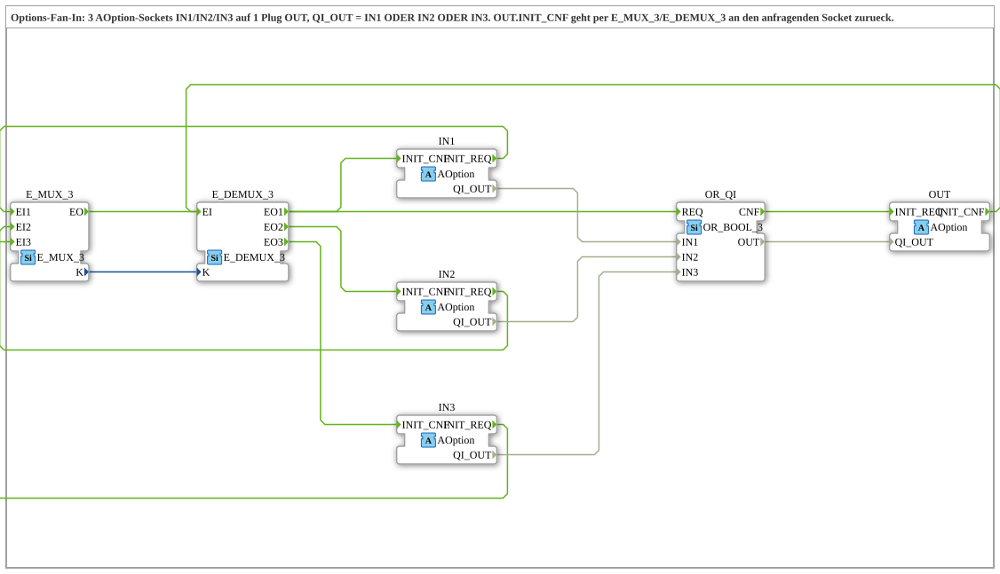

# AOption_OR_3

* * * * * * * * * *

## Einleitung

`AOption_OR_3` ist ein Composite-FB, der als **Fan-In** (ODER-Verknüpfung) für den Options-Adapter [`AOption`](../AOption.md) dient: Drei Optionsanforderungen an den Sockets `IN1`, `IN2` und `IN3` werden zu einer einzigen Anforderung am Plug `OUT` zusammengeführt. `OUT` ist aktiv, solange `IN1` **oder** `IN2` **oder** `IN3` aktiv ist. Variante von [`AOption_OR_2`](AOption_OR_2.md) mit 3 Eingängen.

## Schnittstellenstruktur

### **Ereignis-Eingänge**

Keine vorhanden (die Ereignisse laufen über die Adapter).

### **Ereignis-Ausgänge**

Keine vorhanden.

### **Daten-Eingänge**

Keine vorhanden.

### **Daten-Ausgänge**

Keine vorhanden.

### **Adapter**

| Adapter | Typ | Richtung | Kommentar |
|---------|-----|----------|-----------|
| `IN1` | `Option::AOption` | Socket | Erster AOption-Eingang. |
| `IN2` | `Option::AOption` | Socket | Zweiter AOption-Eingang. |
| `IN3` | `Option::AOption` | Socket | Dritter AOption-Eingang. |
| `OUT` | `Option::AOption` | Plug | Gemeinsamer Ausgang - aktiv, solange `IN1` ODER `IN2` aktiv ist. |

## Funktionsweise

Das interne Netzwerk enthält drei FBs: `E_MUX_3` (`iec61499::events::E_MUX_3`), `OR_QI` (`iec61131::booleanOperators::OR_BOOL_3`) und `E_DEMUX_3` (`iec61499::events::E_DEMUX_3`).

Ereignisse:

- `IN1.INIT_REQ` -> `E_MUX_3.EI1` (`K = 0`), `IN2.INIT_REQ` -> `E_MUX_3.EI2` (`K = 1`) und `IN3.INIT_REQ` -> `E_MUX_3.EI3` (`K = 2`)
- `E_MUX_3.EO` -> `OR_QI.REQ`
- `OR_QI.CNF` -> `OUT.INIT_REQ`
- `OUT.INIT_CNF` -> `E_DEMUX_3.EI`
- `E_DEMUX_3.EO1` -> `IN1.INIT_CNF`, `E_DEMUX_3.EO2` -> `IN2.INIT_CNF` und `E_DEMUX_3.EO3` -> `IN3.INIT_CNF`

Daten:

- `IN1.QI_OUT` -> `OR_QI.IN1`, `IN2.QI_OUT` -> `OR_QI.IN2`, `IN3.QI_OUT` -> `OR_QI.IN3`
- `OR_QI.OUT` -> `OUT.QI_OUT`
- `E_MUX_3.K` -> `E_DEMUX_3.K`

`E_MUX_3` merkt sich in `K`, über welchen Socket die Anforderung kam, und stößt erst danach die ODER-Verknüpfung an. Deren Ergebnis geht als `INIT_REQ` mit `QI_OUT` an `OUT`. Die Bestätigung `OUT.INIT_CNF` leitet `E_DEMUX_3` anhand von `K` an genau den Socket zurück, der angefragt hat.

## Technische Besonderheiten

- **Bestätigung erst nach OUT:** Ein Eingang wird erst bestätigt, wenn die Gruppe am `OUT` fertig ist. Ein vorgeschalteter DEMUX oder [`AOption_T_2`](../splitting/AOption_T_2.md) sieht die Kette also erst als fertig, wenn sie es tatsächlich ist.
- **Reihenfolge per Verdrahtung:** Weil `OR_QI` über `E_MUX_3.EO` angestoßen wird, ist `K` immer gesetzt, bevor `OUT.INIT_REQ` rausgeht.
- **Nur eine offene Anforderung:** `K` fasst genau einen Absender. Kommt die zweite Anforderung, bevor `OUT.INIT_CNF` zurück ist, geht die Zuordnung verloren. Hinter einem DEMUX (Break-before-Make) passiert das nicht; für unabhängige Quellen bräuchte es einen BasicFB mit ECC.
- **Ein DEMUX-Ausgang nur einmal:** Soll derselbe Ausgang zusätzlich eine eigene Gruppe speisen, wird vorher ein [`AOption_T_2`](../splitting/AOption_T_2.md) eingesetzt.

## Anwendungsszenarien

- Eine gemeinsame Optionsgruppe, die bei mehreren Optionen aktiv sein soll, ohne `AOption_OR_2` zu kaskadieren.

## Zusammenfassung

`AOption_OR_3` führt drei `AOption`-Anforderungen zu einer zusammen (`OUT` aktiv, wenn `IN1`, `IN2` oder `IN3` aktiv ist) und gibt die Bestätigung über `E_MUX_3`/`E_DEMUX_3` an den anfragenden Socket zurück.

---

### 🌐 Passende Themen-Unterseiten auf ms-muc-docs.de

- [🌐 Eclipse 4diac IDE & Farb-Referenz auf ms-muc-docs.de](https://www.ms-muc-docs.de/iec-61499/eclipse-4diac/)
