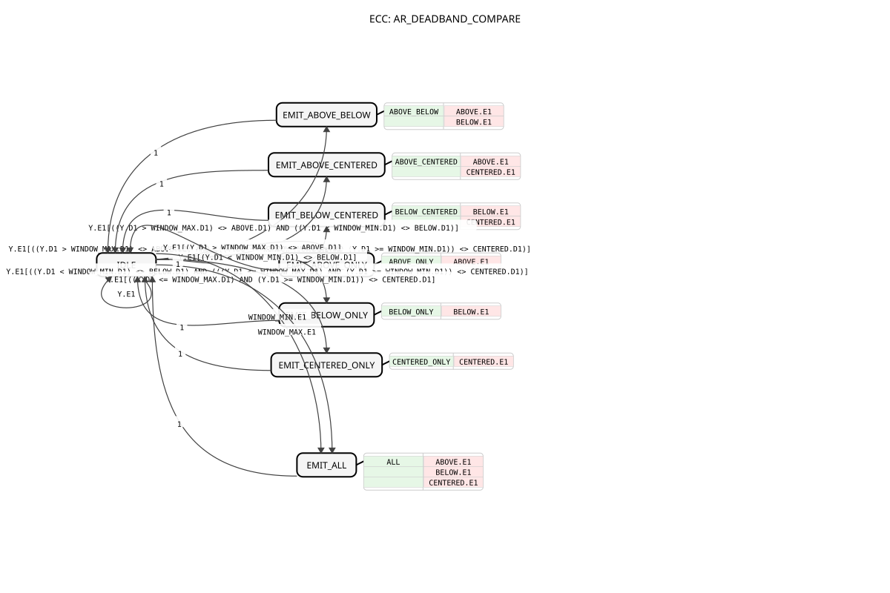

# AR_DEADBAND_COMPARE



* * * * * * * * * *

## Einleitung

`AR_DEADBAND_COMPARE` vergleicht einen `REAL`-Messwert `Y` (über einen `AR`-Socket) mit einem Fenster `[WINDOW_MIN, WINDOW_MAX]` und meldet das Ergebnis über drei `AX`-Plugs: `ABOVE` (`Y > WINDOW_MAX`), `BELOW` (`Y < WINDOW_MIN`) und `CENTERED` (dazwischen). Für ein symmetrisches Totband um Null setzt man `WINDOW_MIN = -Totband` und `WINDOW_MAX = +Totband` (z. B. Lenkwinkel-Zentrierung); der Baustein ist genauso für beliebige Fenster nutzbar (z. B. Farbgrenzen).


## Schnittstellenstruktur

### **Ereignis-Eingänge**

Keine direkten Ereignis-Eingänge – Ereignisse kommen über die Adapter-Sockets (`Y.E1`, `WINDOW_MIN.E1`, `WINDOW_MAX.E1`).

### **Ereignis-Ausgänge**

Keine direkten Ereignis-Ausgänge – Ereignisse werden über die Adapter-Plugs gesendet (`ABOVE.E1`, `BELOW.E1`, `CENTERED.E1`).

### **Daten-Eingänge**

Keine direkten Daten-Eingänge (Werte kommen über die Sockets, Datenport `D1`).

### **Daten-Ausgänge**

Keine direkten Daten-Ausgänge (Werte werden über die Plugs ausgegeben, Datenport `D1`).

### **Adapter**

**Sockets (Eingänge):**

| Adapter | Typ | Beschreibung |
| :--- | :--- | :--- |
| `Y` | `adapter::types::unidirectional::AR` | Zu vergleichender Eingangsmesswert |
| `WINDOW_MIN` | `adapter::types::unidirectional::AR` | Untere Fenstergrenze (z. B. -Totband oder unterer Grenzwert) |
| `WINDOW_MAX` | `adapter::types::unidirectional::AR` | Obere Fenstergrenze (z. B. +Totband oder oberer Grenzwert) |

**Plugs (Ausgänge):**

| Adapter | Typ | Beschreibung |
| :--- | :--- | :--- |
| `ABOVE` | `adapter::types::unidirectional::AX` | TRUE, wenn `Y > WINDOW_MAX`; Ereignis `E1` nur bei Zustandsänderung |
| `CENTERED` | `adapter::types::unidirectional::AX` | TRUE, wenn `WINDOW_MIN <= Y <= WINDOW_MAX` (im Fenster/Totband); Ereignis `E1` nur bei Zustandsänderung |
| `BELOW` | `adapter::types::unidirectional::AX` | TRUE, wenn `Y < WINDOW_MIN`; Ereignis `E1` nur bei Zustandsänderung |

## Funktionsweise

Der Baustein ist ein Basis-FB mit einem Ruhezustand `IDLE` und sieben Sende-Zuständen, die jeweils nach ihrer Aktion sofort (Bedingung `1`) nach `IDLE` zurückkehren.

- **Y-Änderung (`Y.E1`)**: Die Transitionen vergleichen den neu berechneten Wert von `ABOVE`, `BELOW` und `CENTERED` mit dem jeweils gespeicherten Plug-Wert (`<>`). Nur die Ausgänge, deren boolescher Wert sich tatsächlich ändert, werden neu berechnet und senden ihr `E1`:
    - `EMIT_ABOVE_BELOW`: `ABOVE` und `BELOW` ändern sich
    - `EMIT_ABOVE_CENTERED`: `ABOVE` und `CENTERED` ändern sich
    - `EMIT_BELOW_CENTERED`: `BELOW` und `CENTERED` ändern sich
    - `EMIT_ABOVE_ONLY`, `EMIT_BELOW_ONLY`, `EMIT_CENTERED_ONLY`: nur der jeweilige Ausgang ändert sich
    - Ändert sich keiner der Werte, geht der Baustein mit `Y.E1` direkt `IDLE` → `IDLE` ohne Ausgangsereignis.
- **Fenstergrenzen-Änderung (`WINDOW_MIN.E1` oder `WINDOW_MAX.E1`)**: Zustand `EMIT_ALL` berechnet alle drei Ausgänge neu und sendet `ABOVE.E1`, `BELOW.E1` und `CENTERED.E1` (in der Praxis meist nur einmal beim Start).

Berechnungen (Algorithmen in ST):

```text
ABOVE.D1    := Y.D1 > WINDOW_MAX.D1;
BELOW.D1    := Y.D1 < WINDOW_MIN.D1;
CENTERED.D1 := (Y.D1 <= WINDOW_MAX.D1) AND (Y.D1 >= WINDOW_MIN.D1);
```

## Technische Besonderheiten

- **Ereignis-Effizienz**: Bei `Y`-Änderung feuert jeder Plug nur dann, wenn sich sein eigener Wert tatsächlich ändert (nicht alle drei bei jedem Update)
- **Fenstergrenzen**: Bei Änderung von `WINDOW_MIN`/`WINDOW_MAX` werden der Einfachheit halber immer alle drei Ausgänge neu gesetzt
- **Grenzwerte**: Die Grenzen selbst gehören zu `CENTERED` (`<=`/`>=`); `ABOVE` und `BELOW` sind strikt (`>`/`<`)
- Ein fester Wert für eine Grenze kann über `adapter::types::unidirectional::AR::initval::initval_AR` bereitgestellt werden
- Versionshistorie: 1.0 (initial, Achslenkung-Mittelpunkt-Automatik), 1.1 (DEADBAND als AR-Socket), 2.0 (verallgemeinert auf beliebiges Fenster `WINDOW_MIN`/`WINDOW_MAX`)

## Zustandsübersicht

| Zustand | Beschreibung | Aktion |
| :--- | :--- | :--- |
| **IDLE** | Wartet auf Ereignisse an `Y.E1`, `WINDOW_MIN.E1` oder `WINDOW_MAX.E1` | – |
| **EMIT_ABOVE_BELOW** | ABOVE und BELOW aktualisieren | `ABOVE.E1`, `BELOW.E1` |
| **EMIT_ABOVE_CENTERED** | ABOVE und CENTERED aktualisieren | `ABOVE.E1`, `CENTERED.E1` |
| **EMIT_BELOW_CENTERED** | BELOW und CENTERED aktualisieren | `BELOW.E1`, `CENTERED.E1` |
| **EMIT_ABOVE_ONLY** | Nur ABOVE aktualisieren | `ABOVE.E1` |
| **EMIT_BELOW_ONLY** | Nur BELOW aktualisieren | `BELOW.E1` |
| **EMIT_CENTERED_ONLY** | Nur CENTERED aktualisieren | `CENTERED.E1` |
| **EMIT_ALL** | Alle drei aktualisieren (Fenstergrenzen geändert) | `ABOVE.E1`, `BELOW.E1`, `CENTERED.E1` |

## Anwendungsszenarien

- **Lenkwinkel-Mittelpunktzentrierung**: Prüfen, ob ein Lenksensor innerhalb des Totbandes um 0° liegt (`WINDOW_MIN = -Totband`, `WINDOW_MAX = +Totband`)
- **Fenster-/Hysterese-Überwachung**: Auswertung von Grenzwert- oder Farbbereichen (z. B. grün/rot in Visualisierungen)

## Fazit

`AR_DEADBAND_COMPARE` liefert für einen `AR`-Messwert die drei Zustände oberhalb, unterhalb und innerhalb eines Fensters als `AX`-Signale und erzeugt Ereignisse nur bei tatsächlicher Zustandsänderung.
