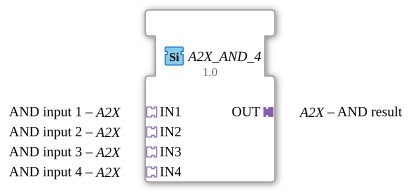

# A2X_AND_4

* * * * * * * * * *

!!! warning "Noch nicht freigegeben"
    Der Baustein ist als Typ in der Bibliothek definiert (Stand 2026-11-13). Die zugehörige Firmware-Seite (C++ und ELF-Bibliotheken) ist noch nicht freigegeben. Bitte noch nicht als lauffähig voraussetzen.

## Einleitung

`A2X_AND_4` verknüpft 4 [A2X](../types/unidirectional/BOOL/A2X.md)-Adapter mit UND, **UP und DOWN getrennt**. Der Baustein ist generisch (`GEN_A2X_AND`), die Zahl der Eingänge steckt im Namen.

## Schnittstellenstruktur

### **Ereignis-Eingänge**

Keine direkten Ereignisse.

### **Ereignis-Ausgänge**

Keine direkten Ereignisse.

### **Daten-Eingänge**

Keine direkten Daten.

### **Daten-Ausgänge**

Keine direkten Daten.

### **Adapter**

| Rolle | Name | Typ | Beschreibung |
| --- | --- | --- | --- |
| Socket | IN1 | adapter::types::unidirectional::A2X | AND input 1 |
| Socket | IN2 | adapter::types::unidirectional::A2X | AND input 2 |
| Socket | IN3 | adapter::types::unidirectional::A2X | AND input 3 |
| Socket | IN4 | adapter::types::unidirectional::A2X | AND input 4 |
| Plug | OUT | adapter::types::unidirectional::A2X | AND result |

## Funktionsweise

Der Adapter-Ausgang `OUT` wird **nur bei einer Wertänderung** aktualisiert, das Ereignis kommt nur bei tatsächlicher Änderung. Für die Variante ohne Änderungserkennung gibt es `A2X_AND_4_UNGATED`.

## Technische Besonderheiten

- Generischer Baustein (`GenericClassName` = `GEN_A2X_AND`), keine eigene Netzwerkdefinition im Typ.
- UP und DOWN werden getrennt verknüpft.
- Die Implementierung liegt in der Firmware (C++), nicht im Typ.

## ⚖️ Vergleich mit ähnlichen Bausteinen

- Gleicher Baustein mit anderer Verknüpfung: [A2X_OR_4](A2X_OR_4.md), [A2X_XOR_4](A2X_XOR_4.md).
- Gleiche Verknüpfung mit anderer Eingangszahl: [A2X_AND_2](A2X_AND_2.md), [A2X_AND_3](A2X_AND_3.md), [A2X_AND_6](A2X_AND_6.md).
- Einkanaliger Vorgänger: [AX_AND_4](AX_AND_4.md).
