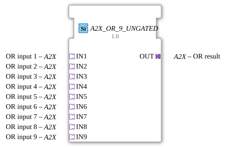

# A2X_OR_9_UNGATED

* * * * * * * * * *

!!! warning "Noch nicht freigegeben"
    Der Baustein ist als Typ in der Bibliothek definiert (Stand 2026-11-13). Die zugehörige Firmware-Seite (C++ und ELF-Bibliotheken) ist noch nicht freigegeben. Bitte noch nicht als lauffähig voraussetzen.

## Einleitung

`A2X_OR_9_UNGATED` verknüpft 9 [A2X](../types/unidirectional/BOOL/A2X.md)-Adapter mit ODER, **UP und DOWN getrennt**. Der Baustein ist generisch (`GEN_A2X_OR`), die Zahl der Eingänge steckt im Namen.

## Schnittstellenstruktur

### **Ereignis-Eingänge**

Keine direkten Ereignisse.

### **Ereignis-Ausgänge**

Keine direkten Ereignisse.

### **Daten-Eingänge**

Keine direkten Daten.

### **Daten-Ausgänge**

Keine direkten Daten.

### **Adapter**

| Rolle | Name | Typ | Beschreibung |
| --- | --- | --- | --- |
| Socket | IN1 | adapter::types::unidirectional::A2X | OR input 1 |
| Socket | IN2 | adapter::types::unidirectional::A2X | OR input 2 |
| Socket | IN3 | adapter::types::unidirectional::A2X | OR input 3 |
| Socket | IN4 | adapter::types::unidirectional::A2X | OR input 4 |
| Socket | IN5 | adapter::types::unidirectional::A2X | OR input 5 |
| Socket | IN6 | adapter::types::unidirectional::A2X | OR input 6 |
| Socket | IN7 | adapter::types::unidirectional::A2X | OR input 7 |
| Socket | IN8 | adapter::types::unidirectional::A2X | OR input 8 |
| Socket | IN9 | adapter::types::unidirectional::A2X | OR input 9 |
| Plug | OUT | adapter::types::unidirectional::A2X | OR result |

## Funktionsweise

Die Variante `_UNGATED` hat **keine Änderungserkennung**: Jedes neu berechnete Ergebnis geht bedingungslos an den Ausgang `OUT`. Das ist für Verbraucher gedacht, die eine periodische Kadenz unabhängig von Wertänderungen brauchen, zum Beispiel Ableitungs- oder Frequenzberechnungen.

## Technische Besonderheiten

- Generischer Baustein (`GenericClassName` = `GEN_A2X_OR`), keine eigene Netzwerkdefinition im Typ.
- UP und DOWN werden getrennt verknüpft.
- Die Implementierung liegt in der Firmware (C++), nicht im Typ.

## ⚖️ Vergleich mit ähnlichen Bausteinen

- Gleicher Baustein mit anderer Verknüpfung: .
- Gleiche Verknüpfung mit anderer Eingangszahl: [A2X_OR_2_UNGATED](A2X_OR_2_UNGATED.md), [A2X_OR_3_UNGATED](A2X_OR_3_UNGATED.md), [A2X_OR_4_UNGATED](A2X_OR_4_UNGATED.md), [A2X_OR_5_UNGATED](A2X_OR_5_UNGATED.md), [A2X_OR_6_UNGATED](A2X_OR_6_UNGATED.md), [A2X_OR_7_UNGATED](A2X_OR_7_UNGATED.md), [A2X_OR_8_UNGATED](A2X_OR_8_UNGATED.md), [A2X_OR_10_UNGATED](A2X_OR_10_UNGATED.md).
- Einkanaliger Vorgänger: [AX_OR_9_UNGATED](AX_OR_9_UNGATED.md).
