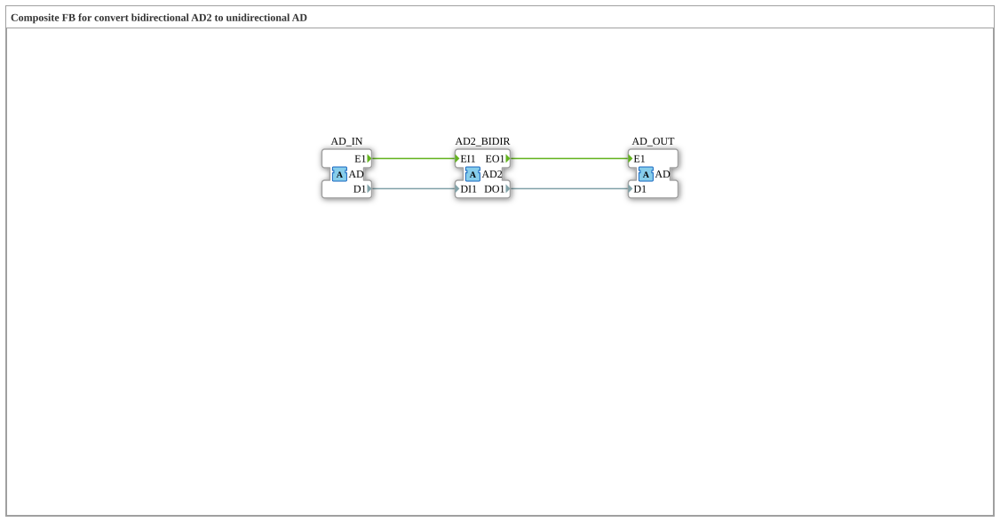

# AD2_TO_AD

* * * * * * * * * *

!!! warning "Noch nicht freigegeben"
    Der Baustein ist als Typ in der Bibliothek definiert (Stand 2026-11-13). Die zugehörige Firmware-Seite (C++ und ELF-Bibliotheken) ist noch nicht freigegeben. Bitte noch nicht als lauffähig voraussetzen.

## Einleitung

`AD2_TO_AD` ist ein Composite-Baustein: Composite FB for convert bidirectional AD2 to unidirectional AD.

## Schnittstellenstruktur

### **Ereignis-Eingänge**

Keine direkten Ereignisse.

### **Ereignis-Ausgänge**

Keine direkten Ereignisse.

### **Daten-Eingänge**

Keine direkten Daten.

### **Daten-Ausgänge**

Keine direkten Daten.

### **Adapter**

| Rolle | Name | Typ | Beschreibung |
| --- | --- | --- | --- |
| Socket | AD2_BIDIR | adapter::types::bidirectional::AD2 | Adapter Input: bidirectional tap, incoming side forwarded to AD_OUT, outgoing side driven by AD_IN |
| Socket | AD_IN | adapter::types::unidirectional::AD | Adapter Input: unidirectional source |
| Plug | AD_OUT | adapter::types::unidirectional::AD | Adapter Output: mirrors AD2_BIDIR's incoming (indication) side |

## Funktionsweise

Die Verbindungen stehen im Abschnitt „Verbindungen im Baustein“. Es gibt keine internen Funktionsbausteine, der Baustein verdrahtet nur Adapter und Ein-/Ausgänge.

## Verbindungen im Baustein

**Ereignisverbindungen:**

- `AD2_BIDIR.EO1` → `AD_OUT.E1`
- `AD_IN.E1` → `AD2_BIDIR.EI1`

**Datenverbindungen:**

- `AD2_BIDIR.DO1` → `AD_OUT.D1`
- `AD_IN.D1` → `AD2_BIDIR.DI1`

## Technische Besonderheiten

- Initial Version - Luecke geschlossen (analog zu AB2_TO_AB)

## ⚖️ Vergleich mit ähnlichen Bausteinen

Bausteine derselben Familie liegen im selben Ordner oder in den Nachbarordnern von `conversion`.
