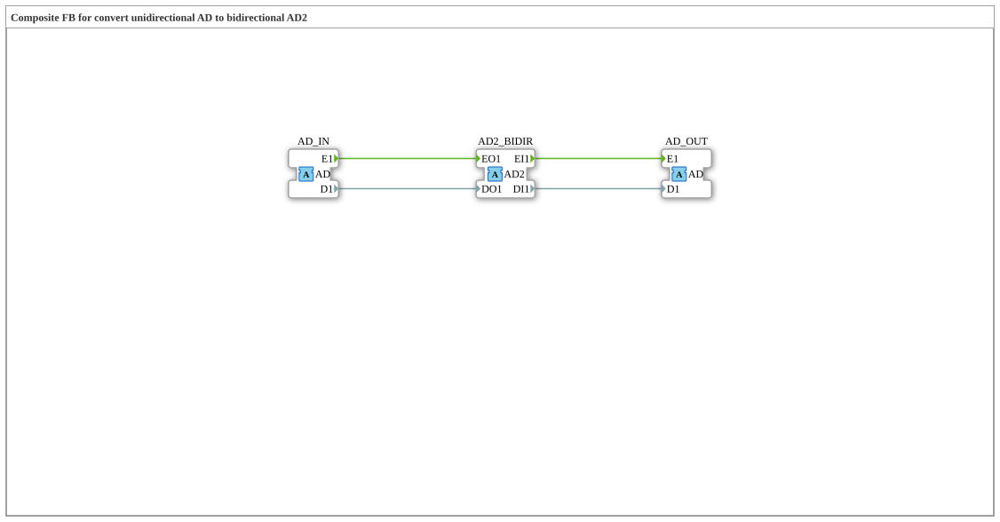

# AD_TO_AD2

* * * * * * * * * *

## Einleitung

Der Funktionsblock AD_TO_AD2 hängt einen bidirektionalen [AD2](../../../types/bidirectional/DWORD/AD2.md)-Abzweig ("Tap") in eine unidirektionale [AD](../../../types/unidirectional/DWORD/AD.md)-Kette ein. Anders als eine einfache 1:1-Konvertierung nutzt er dafür **drei** Adapter: Ein eingehendes unidirektionales AD-Signal wird sowohl auf die bidirektionale AD2-Schnittstelle veröffentlicht als auch – was AD2 auf seiner Anfrage-Seite zurückliefert – als eigenständiges unidirektionales AD-Signal wieder ausgegeben.

## Schnittstellenstruktur

### **Ereignis-Eingänge**

Der Funktionsblock verfügt über keine direkten Ereignis-Eingänge – die Kommunikation läuft ausschließlich über die Adapter.

### **Ereignis-Ausgänge**

Der Funktionsblock verfügt über keine direkten Ereignis-Ausgänge.

### **Daten-Eingänge**

Der Funktionsblock verfügt über keine direkten Daten-Eingänge.

### **Daten-Ausgänge**

Der Funktionsblock verfügt über keine direkten Daten-Ausgänge.

### **Adapter**

- **AD_IN** (Socket): unidirektionale DWORD-Quelle, Typ `adapter::types::unidirectional::AD`
- **AD2_BIDIR** (Plug): bidirektionaler Abzweig, dessen ausgehende Seite von `AD_IN` gespeist wird und dessen eingehende Seite an `AD_OUT` weitergereicht wird, Typ `adapter::types::bidirectional::AD2`
- **AD_OUT** (Plug): spiegelt die eingehende (Anfrage-)Seite von `AD2_BIDIR` als unidirektionales Signal, Typ `adapter::types::unidirectional::AD`

## Funktionsweise

Der Baustein arbeitet in zwei Richtungen gleichzeitig: Was am Socket `AD_IN` eintrifft (`E1`/`D1`), wird direkt auf die ausgehende Seite von `AD2_BIDIR` (`EO1`/`DO1`) veröffentlicht – AD2_BIDIR meldet also nach außen dasselbe Signal, das über AD_IN hereinkommt. Umgekehrt wird alles, was `AD2_BIDIR` auf seiner Anfrage-Seite empfängt (`EI1`/`DI1` – also was ein an AD2_BIDIR angeschlossener bidirektionaler Teilnehmer "zurücksendet"), unverändert als eigenständiges unidirektionales Signal über den Plug `AD_OUT` ausgegeben. AD2_BIDIR fungiert damit als Abzweigpunkt, der die unidirektionale Kette nicht unterbricht, sondern um eine bidirektionale Beobachtungs-/Einspeisemöglichkeit erweitert.

## Technische Besonderheiten

- Drei statt zwei Adapter: Die eingehende und die vom Tap zurückkommende Signalrichtung werden bewusst getrennt gehalten, statt sie zu vermischen
- Reine Verdrahtung ohne Logik oder Zustand, jede Zielvariable hat genau einen Schreiber
- `AD_OUT` gibt nur wieder, was über `AD2_BIDIR` von einem angeschlossenen bidirektionalen Teilnehmer zurückkommt – ohne einen solchen Teilnehmer bleibt `AD_OUT` inaktiv

## Zustandsübersicht

Der Baustein ist zustandslos:

- AD_IN.E1 → AD2_BIDIR.EO1, AD_IN.D1 → AD2_BIDIR.DO1
- AD2_BIDIR.EI1 → AD_OUT.E1, AD2_BIDIR.DI1 → AD_OUT.D1

## Anwendungsszenarien

- Nachträgliches Einhängen eines bidirektionalen Diagnose- oder Steuerpunkts in eine bestehende unidirektionale AD-Signalkette, ohne diese zu unterbrechen
- Systeme, in denen ein bidirektionaler Teilnehmer (z. B. ein Bedienpanel) sowohl den Status eines unidirektionalen Byte-Signalgebers anzeigen als auch selbst Kommandos zurücksenden soll
- Brücke zwischen einer unidirektionalen AD-Zone und einer bidirektionalen AD2-Zone

## ⚖️ Vergleich mit ähnlichen Bausteinen

AD_TO_AD2 gehört zur Konvertierungsfamilie der Abzweig-Bausteine (analog zu [AB_TO_AB2](../BYTE/AB_TO_AB2.md) für BYTE): ein unidirektionales [AD](../../../types/unidirectional/DWORD/AD.md)-Signal wird an einem bidirektionalen [AD2](../../../types/bidirectional/DWORD/AD2.md)-Punkt abgegriffen.

## Fazit

AD_TO_AD2 ist kein einfacher Konverter, sondern ein Abzweigpunkt: Es macht ein unidirektionales AD-Signal an einem bidirektionalen AD2-Punkt sichtbar, ohne die ursprüngliche unidirektionale Signalkette zu unterbrechen, und gibt gleichzeitig das dort empfangene Anfrage-Signal als eigenständiges AD-Signal weiter.

## 🛠️ Zugehörige Übungen

- [Uebung_094b5_AX](https://meisterschulen-am-ostbahnhof-munchen-docs.readthedocs.io/projects/4diac-exercises-docs/de/latest/Uebungen/test_AX/Uebungen_doc/Uebung_094b5_AX/)

