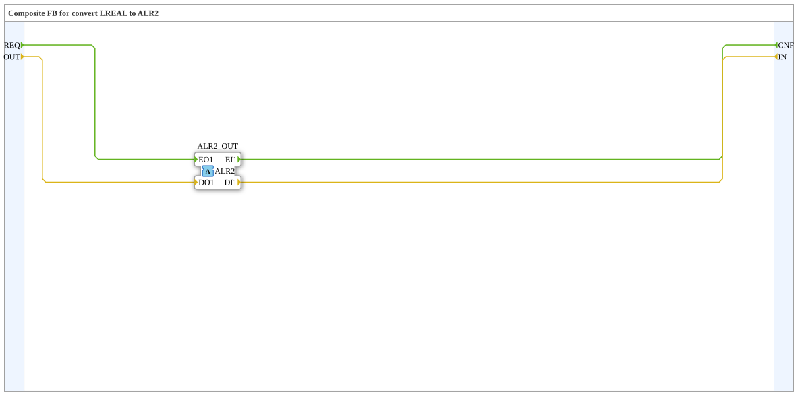

# ALR2_LREAL_TO_R

* * * * * * * * * *

## Einleitung

`ALR2_LREAL_TO_R` ist ein Composite-FB, der zwischen einem `LREAL`-Datenpaar (`OUT`/`IN`) und dem bidirektionalen Adapter `ALR2` vermittelt. Er vervollständigt die Konvertierungsfamilie analog zu `AR2`/`AB2`/`AE2`.

## Schnittstellenstruktur

### **Ereignis-Eingänge**

- `REQ`: Anforderung an den Adapter. Verbundene Daten: `OUT`.

### **Ereignis-Ausgänge**

- `CNF`: Bestätigung vom Adapter. Verbundene Daten: `IN`.

### **Daten-Eingänge**

- `OUT` (`LREAL`): Wert, der zum Adapter gesendet wird.

### **Daten-Ausgänge**

- `IN` (`LREAL`): Vom Adapter empfangener Wert.

### **Adapter**

| Richtung | Name | Adaptertyp | Kommentar |
| :--- | :--- | :--- | :--- |
| **Plug** (Ausgang) | `ALR2_OUT` | `adapter::types::bidirectional::ALR2` | Adapter-Ausgang. |

## Funktionsweise

Der Baustein enthält keine internen FBs, sondern nur Verbindungen:

- `REQ` → `ALR2_OUT.EO1` und `OUT` → `ALR2_OUT.DO1`: Ein `REQ`-Ereignis sendet den Wert `OUT` über den Adapter.
- `ALR2_OUT.EI1` → `CNF` und `ALR2_OUT.DI1` → `IN`: Ein über den Adapter empfangenes Ereignis wird als `CNF` ausgegeben, der empfangene Wert erscheint an `IN`.

## Technische Besonderheiten

- Reine Durchreichung ohne Logik.
- Der Datentyp ist `LREAL` (64 Bit Gleitkomma).
- Die Benennung `OUT`/`IN` ist aus Sicht des Adapters gewählt: `OUT` geht zum Adapter hinaus, `IN` kommt vom Adapter herein.

## Anwendungsszenarien

- Einen `LREAL`-Wert auf einen bidirektionalen `ALR2`-Adapter ausgeben und gleichzeitig dessen Rückkanal als Datenausgang auslesen.

## Zusammenfassung

`ALR2_LREAL_TO_R` verbindet Ereignisse und `LREAL`-Daten 1:1 mit dem bidirektionalen Adapter `ALR2`.

---

### 🌐 Passende Themen-Unterseiten auf ms-muc-docs.de

- [🌐 Eclipse 4diac IDE & Farb-Referenz auf ms-muc-docs.de](https://www.ms-muc-docs.de/iec-61499/eclipse-4diac/)
