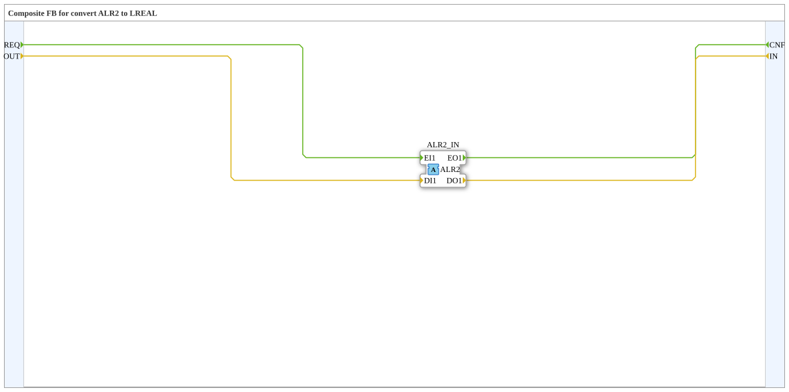

# ALR2_R_TO_LREAL

* * * * * * * * * *

## Einleitung

`ALR2_R_TO_LREAL` ist ein Composite-FB, der zwischen einem `LREAL`-Datenpaar (`OUT`/`IN`) und dem bidirektionalen Adapter `ALR2` vermittelt. Im Gegensatz zur Plug-Variante `ALR2_LREAL_TO_R` besitzt er einen Adapter-**Socket** (Eingang). Er vervollständigt die Konvertierungsfamilie analog zu `AR2`/`AB2`/`AE2`.

## Schnittstellenstruktur

### **Ereignis-Eingänge**

- `REQ`: Anforderung an den Adapter. Verbundene Daten: `OUT`.

### **Ereignis-Ausgänge**

- `CNF`: Bestätigung vom Adapter. Verbundene Daten: `IN`.

### **Daten-Eingänge**

- `OUT` (`LREAL`): Wert, der zum Adapter gesendet wird.

### **Daten-Ausgänge**

- `IN` (`LREAL`): Vom Adapter empfangener Wert.

### **Adapter**

| Richtung | Name | Adaptertyp | Kommentar |
| :--- | :--- | :--- | :--- |
| **Socket** (Eingang) | `ALR2_IN` | `adapter::types::bidirectional::ALR2` | Adapter-Eingang. |

## Funktionsweise

Der Baustein enthält keine internen FBs, sondern nur Verbindungen:

- `REQ` → `ALR2_IN.EI1` und `OUT` → `ALR2_IN.DI1`: Ein `REQ`-Ereignis sendet den Wert `OUT` über den Adapter.
- `ALR2_IN.EO1` → `CNF` und `ALR2_IN.DO1` → `IN`: Ein vom Adapter kommendes Ereignis wird als `CNF` ausgegeben, der empfangene Wert erscheint an `IN`.

## Technische Besonderheiten

- Reine Durchreichung ohne Logik und ohne internen Zustand.
- Der Datentyp ist `LREAL` (64-Bit-Gleitkomma).
- Die Benennung `OUT`/`IN` ist aus Sicht des Adapters gewählt: `OUT` geht zum Adapter hinaus, `IN` kommt vom Adapter herein.

## Anwendungsszenarien

- Einen `LREAL`-Wert auf einen bidirektionalen `ALR2`-Adapter ausgeben und gleichzeitig dessen Rückkanal als Datenausgang auslesen, wenn der Adapter als Socket vorliegt.

## Zusammenfassung

`ALR2_R_TO_LREAL` verbindet Ereignisse und `LREAL`-Daten 1:1 mit dem bidirektionalen Adapter `ALR2` (Socket-Variante).
