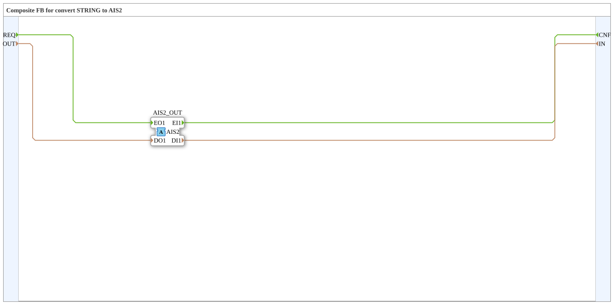

# AIS2_STRING_TO_S

* * * * * * * * * *

## Einleitung

`AIS2_STRING_TO_S` ist ein Composite-Funktionsblock, der einen bidirektionalen `AIS2`-Adapter (Plug `AIS2_OUT`) mit einem klassischen Ereignis-/Daten-Interface vom Typ `STRING` verbindet. Das Ereignis `REQ` mit dem Dateneingang `OUT` wird auf den Adapter geschrieben, Ereignis und Wert aus dem Adapter erscheinen als `CNF` mit dem Datenausgang `IN`. Der Baustein gehört zur Konvertierungsfamilie (analog zu `AR2`/`AB2`/`AE2`).

## Schnittstellenstruktur

### **Ereignis-Eingänge**

- **REQ**: Anforderung an den Adapter (zugeordnetes Datum: `OUT`)

### **Ereignis-Ausgänge**

- **CNF**: Bestätigung vom Adapter (zugeordnetes Datum: `IN`)

### **Daten-Eingänge**

- **OUT** (`STRING`): Wert, der zum Adapter gesendet wird

### **Daten-Ausgänge**

- **IN** (`STRING`): Vom Adapter empfangener Wert (Input data from Adapter)

### **Adapter**

- **AIS2_OUT** (Plug): Bidirektionaler Adapter vom Typ `adapter::types::bidirectional::AIS2` (Adapter-Ausgang)

## Funktionsweise

1. **Senden**: `REQ` wird auf `AIS2_OUT.EO1` und `OUT` auf `AIS2_OUT.DO1` geleitet.
2. **Empfangen**: `AIS2_OUT.EI1` wird auf `CNF` und `AIS2_OUT.DI1` auf `IN` geleitet.

## Technische Besonderheiten

- Reine Ereignis-/Datenverbindungen (`FBNetwork`), keine eigene Logik und kein interner Zustand
- Der Datentyp ist auf beiden Seiten `STRING`, es findet keine Wertumrechnung statt
- Version 1.0 (2026-09-12): Konvertierungsfamilie vervollständigt

## Anwendungsszenarien

- Anbindung eines Bausteins mit einfachem `REQ`/`CNF`-Interface an eine bidirektionale `AIS2`-Adapterverbindung
- Brücke zwischen Ereignis-/Datenports und Adapter bei `STRING`-Werten

## Fazit

`AIS2_STRING_TO_S` übersetzt ein einfaches `STRING`-Ereignis-/Daten-Interface 1:1 in einen bidirektionalen `AIS2`-Adapter und zurück.
