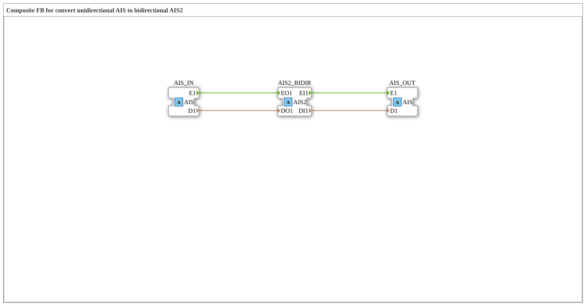

# AIS_TO_AIS2

* * * * * * * * * *

## Einleitung

Der Funktionsblock `AIS_TO_AIS2` hängt einen bidirektionalen [`AIS2`](../../../types/bidirectional/STRING/AIS2.md)-Abzweig ("Tap") in eine unidirektionale [`AIS`](../../../types/unidirectional/STRING/AIS.md)-Kette (STRING) ein. Er nutzt dafür **drei** Adapter: Ein eingehendes unidirektionales AIS-Signal wird auf die bidirektionale AIS2-Schnittstelle veröffentlicht, und was AIS2 auf seiner Anfrage-Seite zurückliefert, wird als eigenständiges unidirektionales AIS-Signal wieder ausgegeben.

## Schnittstellenstruktur

### **Ereignis-Eingänge**

Der Funktionsblock verfügt über keine direkten Ereignis-Eingänge.

### **Ereignis-Ausgänge**

Der Funktionsblock verfügt über keine direkten Ereignis-Ausgänge.

### **Daten-Eingänge**

Der Funktionsblock verfügt über keine direkten Daten-Eingänge.

### **Daten-Ausgänge**

Der Funktionsblock verfügt über keine direkten Daten-Ausgänge.

### **Adapter**

- **AIS_IN** (Socket): unidirektionale STRING-Quelle, Typ `adapter::types::unidirectional::AIS`
- **AIS2_BIDIR** (Plug): bidirektionaler Abzweig, dessen ausgehende Seite von `AIS_IN` gespeist wird und dessen eingehende Seite an `AIS_OUT` weitergereicht wird, Typ `adapter::types::bidirectional::AIS2`
- **AIS_OUT** (Plug): spiegelt die eingehende (Anfrage-)Seite von `AIS2_BIDIR` als unidirektionales Signal, Typ `adapter::types::unidirectional::AIS`

## Funktionsweise

Der Baustein arbeitet in zwei Richtungen gleichzeitig: Was am Socket `AIS_IN` eintrifft (`E1`/`D1`), wird direkt auf die ausgehende Seite von `AIS2_BIDIR` (`EO1`/`DO1`) veröffentlicht. Umgekehrt wird alles, was `AIS2_BIDIR` auf seiner Anfrage-Seite empfängt (`EI1`/`DI1`), unverändert als eigenständiges unidirektionales Signal über den Plug `AIS_OUT` ausgegeben. `AIS2_BIDIR` fungiert damit als Abzweigpunkt, der die unidirektionale Kette nicht unterbricht, sondern um eine bidirektionale Beobachtungs-/Einspeisemöglichkeit erweitert.

## Technische Besonderheiten

- Drei statt zwei Adapter: Die eingehende und die vom Tap zurückkommende Signalrichtung werden bewusst getrennt gehalten
- Reine Verdrahtung ohne Logik oder Zustand, jede Zielvariable hat genau einen Schreiber
- `AIS_OUT` gibt nur wieder, was über `AIS2_BIDIR` von einem angeschlossenen bidirektionalen Teilnehmer zurückkommt; ohne einen solchen Teilnehmer bleibt `AIS_OUT` inaktiv

## Zustandsübersicht

Der Baustein ist zustandslos:

- AIS_IN.E1 → AIS2_BIDIR.EO1, AIS_IN.D1 → AIS2_BIDIR.DO1
- AIS2_BIDIR.EI1 → AIS_OUT.E1, AIS2_BIDIR.DI1 → AIS_OUT.D1

## Anwendungsszenarien

- Nachträgliches Einhängen eines bidirektionalen Diagnose- oder Steuerpunkts in eine bestehende unidirektionale AIS-Signalkette, ohne diese zu unterbrechen
- Brücke zwischen einer unidirektionalen AIS-Zone und einer bidirektionalen AIS2-Zone

## ⚖️ Vergleich mit ähnlichen Bausteinen

Das Gegenstück in umgekehrter Richtung ist der Baustein `AIS2_TO_AIS` (dort steht `AIS2_BIDIR` als Socket auf der linken Seite). Die Bausteine dieser Konvertierungsfamilie existieren analog für die Adapter `AR`/`AR2`, `AB`/`AB2` und `AE`/`AE2`.

## Fazit

`AIS_TO_AIS2` ist kein einfacher Konverter, sondern ein Abzweigpunkt: Er macht ein unidirektionales AIS-Signal an einem bidirektionalen AIS2-Punkt sichtbar, ohne die ursprüngliche Signalkette zu unterbrechen, und gibt das dort empfangene Anfrage-Signal als eigenständiges AIS-Signal weiter.
