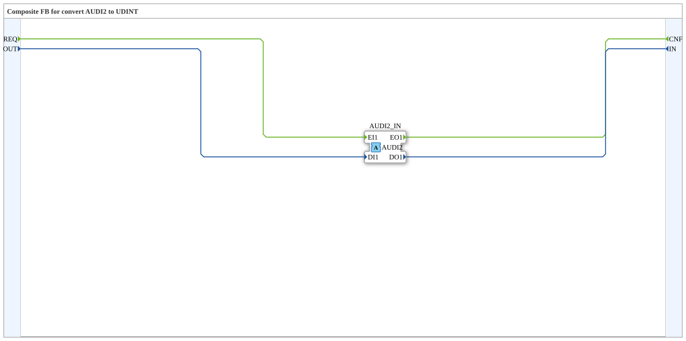

# AUDI2_I_TO_UDINT

* * * * * * * * * *

## Einleitung

`AUDI2_I_TO_UDINT` ist ein Composite-Funktionsblock, der den bidirektionalen Adapter [AUDI2](../../../types/bidirectional/UDINT/AUDI2.md) auf einfache Ereignis- und UDINT-Datenports abbildet. Er gehört zur Konvertierungsfamilie analog zu AR2/AB2/AE2.

## Schnittstellenstruktur

### **Ereignis-Eingänge**

- **REQ** (Request to Adapter): Sendet die Daten `OUT` über den Adapter (assoziiert mit `OUT`)

### **Ereignis-Ausgänge**

- **CNF** (Confirmation from Adapter): Wird ausgelöst, wenn der Adapter ein Ereignis auf seiner eingehenden Seite liefert (assoziiert mit `IN`)

### **Daten-Eingänge**

- **OUT** (UDINT): Daten, die an den Adapter gesendet werden

### **Daten-Ausgänge**

- **IN** (UDINT): Vom Adapter empfangene Daten

### **Adapter**

- **AUDI2_IN** (Socket): Adapter vom Typ `adapter::types::bidirectional::AUDI2`

## Funktionsweise

Der Baustein besteht nur aus Verdrahtung ohne eigene Logik:

- `REQ` → `AUDI2_IN.EI1` und `OUT` → `AUDI2_IN.DI1`: Der Anfrage-Ereignisstrom samt Daten wird auf die ausgehende Seite des Adapters veröffentlicht.
- `AUDI2_IN.EO1` → `CNF` und `AUDI2_IN.DO1` → `IN`: Was auf der eingehenden Seite des Adapters gemeldet wird, erscheint als Ereignis `CNF` mit den Daten `IN`.

## Technische Besonderheiten

- Zustandsloser Composite-Baustein ohne Algorithmen
- Jede Zielvariable hat genau einen Schreiber
- Die Adapterdaten werden unverändert durchgereicht, es findet keine Wertumwandlung statt

## Anwendungsszenarien

- Anbindung klassischer Ereignis-/Datenports an einen bidirektionalen AUDI2-Adapter
- Einbindung von Bausteinen mit UDINT-Ports in adapterbasierte Netzwerke

## Fazit

`AUDI2_I_TO_UDINT` setzt den bidirektionalen AUDI2-Adapter ohne Logik auf die Ports `REQ`/`OUT` und `CNF`/`IN` um.
