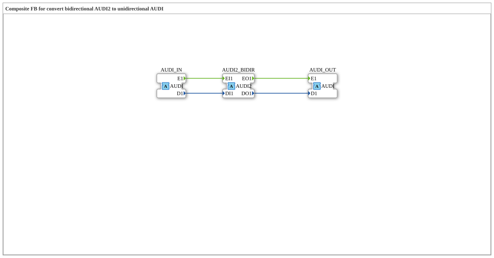

# AUDI2_TO_AUDI

* * * * * * * * * *

## Einleitung

Der Funktionsblock AUDI2_TO_AUDI ist das Spiegelbild von [AUDI_TO_AUDI2](AUDI_TO_AUDI2.md): Hier steht der bidirektionale [AUDI2](../../../types/bidirectional/UDINT/AUDI2.md)-Abzweig als Socket auf der linken (Eingangs-)Seite, ergänzt um einen zweiten unidirektionalen [AUDI](../../../types/unidirectional/UDINT/AUDI.md)-Socket und einen unidirektionalen AUDI-Plug.

## Schnittstellenstruktur

### **Ereignis-Eingänge**

Der Funktionsblock verfügt über keine direkten Ereignis-Eingänge – die Kommunikation läuft ausschließlich über die Adapter.

### **Ereignis-Ausgänge**

Der Funktionsblock verfügt über keine direkten Ereignis-Ausgänge.

### **Daten-Eingänge**

Der Funktionsblock verfügt über keine direkten Daten-Eingänge.

### **Daten-Ausgänge**

Der Funktionsblock verfügt über keine direkten Daten-Ausgänge.

### **Adapter**

- **AUDI2_BIDIR** (Socket): bidirektionaler Abzweig, dessen eingehende Seite an `AUDI_OUT` weitergereicht wird und dessen ausgehende Seite von `AUDI_IN` gespeist wird, Typ `adapter::types::bidirectional::AUDI2`
- **AUDI_IN** (Socket): unidirektionale UDINT-Quelle, Typ `adapter::types::unidirectional::AUDI`
- **AUDI_OUT** (Plug): spiegelt die eingehende (Indikations-)Seite von `AUDI2_BIDIR` als unidirektionales Signal, Typ `adapter::types::unidirectional::AUDI`

## Funktionsweise

Der Baustein arbeitet in zwei Richtungen gleichzeitig: Was der Socket `AUDI2_BIDIR` auf seiner Indikations-Seite empfängt (`EO1`/`DO1` – also was ein an AUDI2_BIDIR angeschlossener bidirektionaler Teilnehmer meldet), wird unverändert als eigenständiges unidirektionales Signal über den Plug `AUDI_OUT` ausgegeben. Umgekehrt wird alles, was am Socket `AUDI_IN` eintrifft (`E1`/`D1`), auf die Anfrage-Seite von `AUDI2_BIDIR` (`EI1`/`DI1`) veröffentlicht – AUDI2_BIDIR sendet also dasselbe Signal an den angeschlossenen bidirektionalen Teilnehmer weiter.

## Technische Besonderheiten

- Drei statt zwei Adapter: Die vom Tap empfangene und die separat eingespeiste Signalrichtung werden bewusst getrennt gehalten, statt sie zu vermischen
- Reine Verdrahtung ohne Logik oder Zustand, jede Zielvariable hat genau einen Schreiber
- `AUDI_OUT` gibt nur wieder, was über `AUDI2_BIDIR` von einem angeschlossenen bidirektionalen Teilnehmer gemeldet wird – ohne einen solchen Teilnehmer bleibt `AUDI_OUT` inaktiv

## Zustandsübersicht

Der Baustein ist zustandslos:

- AUDI2_BIDIR.EO1 → AUDI_OUT.E1, AUDI2_BIDIR.DO1 → AUDI_OUT.D1
- AUDI_IN.E1 → AUDI2_BIDIR.EI1, AUDI_IN.D1 → AUDI2_BIDIR.DI1

## Anwendungsszenarien

- Auslesen des Status eines bidirektionalen AUDI2-Teilnehmers als einfaches unidirektionales AUDI-Signal, kombiniert mit dem Einspeisen eines separaten unidirektionalen Kommandosignals
- Systeme, in denen ein bidirektionaler Teilnehmer überwacht werden soll, ohne die restliche Steuerung auf AUDI2 umzustellen
- Brücke zwischen einer bidirektionalen AUDI2-Zone und einer unidirektionalen AUDI-Zone

## ⚖️ Vergleich mit ähnlichen Bausteinen

[AUDI_TO_AUDI2](AUDI_TO_AUDI2.md) ist das Spiegelbild dieses Bausteins – dort steht `AUDI2_BIDIR` als Plug auf der rechten Seite.

## Fazit

AUDI2_TO_AUDI ist kein einfacher Konverter, sondern ein Abzweigpunkt: Es macht den Zustand eines bidirektionalen AUDI2-Teilnehmers als eigenständiges unidirektionales AUDI-Signal sichtbar und speist gleichzeitig ein separates unidirektionales Signal in die bidirektionale Seite ein.
