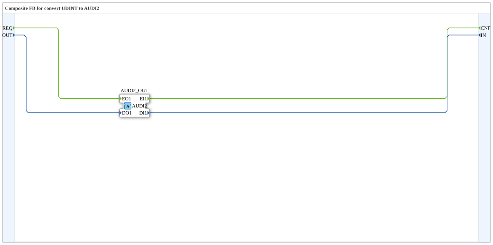

# AUDI2_UDINT_TO_I

* * * * * * * * * *

## Einleitung

`AUDI2_UDINT_TO_I` ist ein Composite-Funktionsblock, der zwischen klassischen Ereignis-/Datenanschlüssen vom Typ `UDINT` und einem **bidirektionalen** `AUDI2`-Adapter vermittelt. Der Eingang `OUT` wird bei `REQ` auf die ausgehende Seite des Adapter-Plugs `AUDI2_OUT` geschrieben; der über die Rückrichtung des Adapters gemeldete Wert erscheint am Ausgang `IN` und wird mit `CNF` bestätigt.

## Schnittstellenstruktur

### **Ereignis-Eingänge**

- **REQ**: Anforderung an den Adapter. Verbundene Daten: `OUT`

### **Ereignis-Ausgänge**

- **CNF**: Bestätigung vom Adapter. Verbundene Daten: `IN`

### **Daten-Eingänge**

- **OUT** (`UDINT`): Daten, die an den Adapter gesendet werden

### **Daten-Ausgänge**

- **IN** (`UDINT`): Vom Adapter empfangene Daten

### **Adapter**

- **AUDI2_OUT** (Plug): Bidirektionaler Adapter vom Typ `adapter::types::bidirectional::AUDI2` (Adapter-Ausgang)

## Funktionsweise

1. `REQ` wird an `AUDI2_OUT.EO1` weitergeleitet, `OUT` an `AUDI2_OUT.DO1`.
2. `AUDI2_OUT.EI1` wird an `CNF` weitergeleitet, `AUDI2_OUT.DI1` an `IN`.

## Technische Besonderheiten

- Reine Ereignis-/Datenverbindungen (`FBNetwork`), keine eigene Logik und kein interner Zustand
- Teil der Konvertierungsfamilie (analog zu `AR2`/`AB2`/`AE2`)

## Anwendungsszenarien

- Anbindung von `UDINT`-Werten aus klassischen Funktionsbaustein-Netzen an einen bidirektionalen `AUDI2`-Adapter

## Fazit

`AUDI2_UDINT_TO_I` überführt `UDINT`-Ereignis-/Datenanschlüsse 1:1 in die beiden Richtungen eines `AUDI2`-Adapters.
