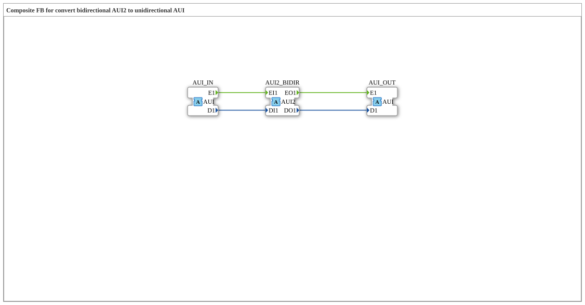

# AUI2_TO_AUI

* * * * * * * * * *

## Einleitung

`AUI2_TO_AUI` ist ein Composite-Funktionsblock zur Konvertierung eines **bidirektionalen** `AUI2`-Adapters in einen **unidirektionalen** `AUI`-Adapter. Die eingehende Seite (`EO1`/`DO1`) des bidirektionalen Adapters wird als einfaches unidirektionales Signal über `AUI_OUT` ausgegeben; über `AUI_IN` wird ein Wert auf die ausgehende Seite (`EI1`/`DI1`) des bidirektionalen Adapters geschrieben.

## Schnittstellenstruktur

### **Ereignis-Eingänge**

*Keine direkten Ereignis-Eingänge vorhanden – Ereignisse kommen über die Adapter-Sockets/-Plugs*

### **Ereignis-Ausgänge**

*Keine direkten Ereignis-Ausgänge vorhanden*

### **Daten-Eingänge**

*Keine Daten-Eingänge vorhanden*

### **Daten-Ausgänge**

*Keine Daten-Ausgänge vorhanden*

### **Adapter**

- **AUI2_BIDIR** (Socket): Bidirektionaler Adapter vom Typ `adapter::types::bidirectional::AUI2` – die eingehende Seite wird an `AUI_OUT` weitergeleitet, die ausgehende Seite wird von `AUI_IN` getrieben
- **AUI_IN** (Socket): Unidirektionaler Adapter vom Typ `adapter::types::unidirectional::AUI` – unidirektionale Quelle
- **AUI_OUT** (Plug): Unidirektionaler Adapter vom Typ `adapter::types::unidirectional::AUI` – spiegelt die eingehende (Indikations-)Seite von `AUI2_BIDIR`

## Funktionsweise

1. `AUI2_BIDIR.EO1` wird an `AUI_OUT.E1` und `AUI2_BIDIR.DO1` an `AUI_OUT.D1` weitergeleitet.
2. `AUI_IN.E1` wird an `AUI2_BIDIR.EI1` und `AUI_IN.D1` an `AUI2_BIDIR.DI1` weitergeleitet.

## Technische Besonderheiten

- Reine Ereignis-/Datenverbindungen (`FBNetwork`), keine eigene Logik und kein interner Zustand
- Teil der Konvertierungsfamilie (analog zu `AR2`/`AB2`/`AE2`)

## Anwendungsszenarien

- Anbindung eines unidirektionalen `AUI`-Verbrauchers bzw. -Erzeugers an einen bidirektionalen `AUI2`-Adapter

## Fazit

`AUI2_TO_AUI` trennt die beiden Richtungen eines bidirektionalen `AUI2`-Adapters in einen unidirektionalen Ausgang (`AUI_OUT`) und einen unidirektionalen Eingang (`AUI_IN`).
