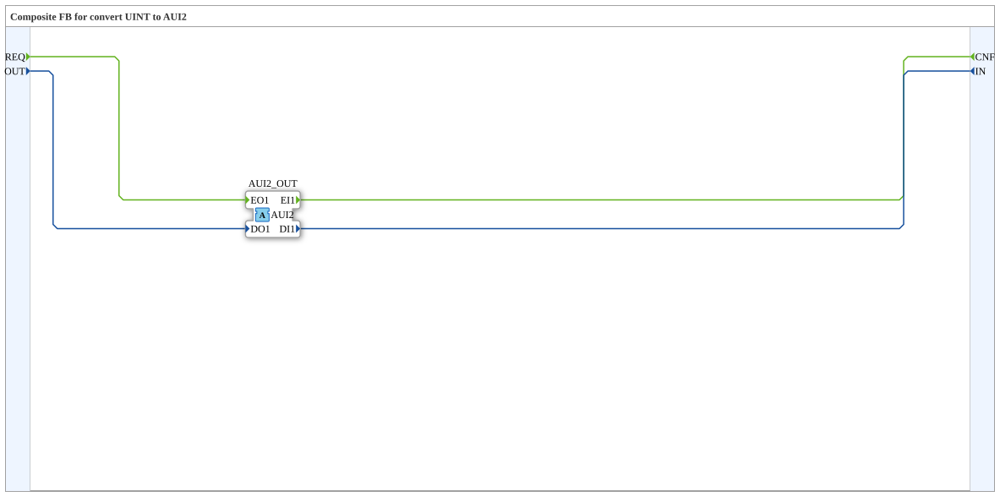

# AUI2_UINT_TO_I

* * * * * * * * * *

## Einleitung

`AUI2_UINT_TO_I` ist ein Composite-Funktionsblock, der die einfachen Ereignis- und `UINT`-Datenports `REQ`/`OUT` und `CNF`/`IN` auf den bidirektionalen Adapter [`AUI2`](../../../types/bidirectional/UINT/AUI2.md) (als Plug) abbildet. Er gehört zur Konvertierungsfamilie analog zu AR2/AB2/AE2.

## Schnittstellenstruktur

### **Ereignis-Eingänge**

- **REQ** (Request to Adapter): sendet die Daten `OUT` über den Adapter (assoziiert mit `OUT`)

### **Ereignis-Ausgänge**

- **CNF** (Confirmation from Adapter): wird ausgelöst, wenn der Adapter ein Ereignis auf seiner eingehenden Seite liefert (assoziiert mit `IN`)

### **Daten-Eingänge**

- **OUT** (UINT): Daten, die an den Adapter gesendet werden

### **Daten-Ausgänge**

- **IN** (UINT): vom Adapter empfangene Daten

### **Adapter**

- **AUI2_OUT** (Plug): Adapter vom Typ `adapter::types::bidirectional::AUI2`

## Funktionsweise

Der Baustein besteht nur aus Verdrahtung ohne eigene Logik:

- `REQ` → `AUI2_OUT.EO1` und `OUT` → `AUI2_OUT.DO1`: Der Anfrage-Ereignisstrom samt Daten wird auf die ausgehende Seite des Adapters veröffentlicht.
- `AUI2_OUT.EI1` → `CNF` und `AUI2_OUT.DI1` → `IN`: Was auf der eingehenden Seite des Adapters gemeldet wird, erscheint als Ereignis `CNF` mit den Daten `IN`.

## Technische Besonderheiten

- Zustandsloser Composite-Baustein ohne Algorithmen
- Jede Zielvariable hat genau einen Schreiber
- Die Adapterdaten werden unverändert durchgereicht, es findet keine Wertumwandlung statt
- Der Adapter wird hier als Plug geführt, der Baustein steht also am Anfang einer AUI2-Verbindung

## Anwendungsszenarien

- Anbindung klassischer Ereignis-/Datenports an einen bidirektionalen AUI2-Adapter
- Einbindung von Bausteinen mit `UINT`-Ports in adapterbasierte Netzwerke

## Fazit

`AUI2_UINT_TO_I` setzt die Ports `REQ`/`OUT` und `CNF`/`IN` ohne Logik auf den bidirektionalen AUI2-Adapter um.
