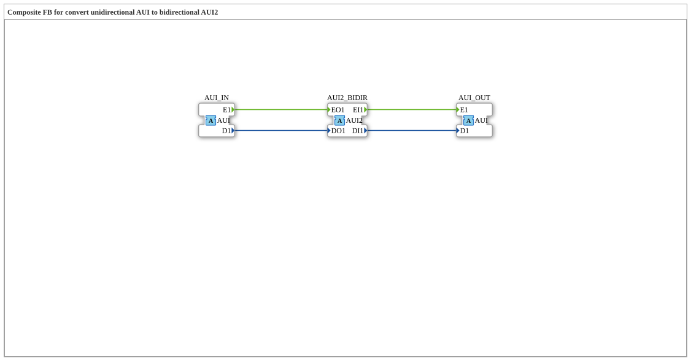

# AUI_TO_AUI2

* * * * * * * * * *

## Einleitung

Der Funktionsblock `AUI_TO_AUI2` hängt einen bidirektionalen [`AUI2`](../../../types/bidirectional/UINT/AUI2.md)-Abzweig ("Tap") in eine unidirektionale [`AUI`](../../../types/unidirectional/UINT/AUI.md)-Kette (UINT) ein. Er nutzt dafür **drei** Adapter: Ein eingehendes unidirektionales AUI-Signal wird auf die bidirektionale AUI2-Schnittstelle veröffentlicht, und was AUI2 auf seiner Anfrage-Seite zurückliefert, wird als eigenständiges unidirektionales AUI-Signal wieder ausgegeben.

## Schnittstellenstruktur

### **Ereignis-Eingänge**

Der Funktionsblock verfügt über keine direkten Ereignis-Eingänge.

### **Ereignis-Ausgänge**

Der Funktionsblock verfügt über keine direkten Ereignis-Ausgänge.

### **Daten-Eingänge**

Der Funktionsblock verfügt über keine direkten Daten-Eingänge.

### **Daten-Ausgänge**

Der Funktionsblock verfügt über keine direkten Daten-Ausgänge.

### **Adapter**

- **AUI_IN** (Socket): unidirektionale UINT-Quelle, Typ `adapter::types::unidirectional::AUI`
- **AUI2_BIDIR** (Plug): bidirektionaler Abzweig, dessen ausgehende Seite von `AUI_IN` gespeist wird und dessen eingehende Seite an `AUI_OUT` weitergereicht wird, Typ `adapter::types::bidirectional::AUI2`
- **AUI_OUT** (Plug): spiegelt die eingehende (Anfrage-)Seite von `AUI2_BIDIR` als unidirektionales Signal, Typ `adapter::types::unidirectional::AUI`

## Funktionsweise

Der Baustein arbeitet in zwei Richtungen gleichzeitig: Was am Socket `AUI_IN` eintrifft (`E1`/`D1`), wird direkt auf die ausgehende Seite von `AUI2_BIDIR` (`EO1`/`DO1`) veröffentlicht. Umgekehrt wird alles, was `AUI2_BIDIR` auf seiner Anfrage-Seite empfängt (`EI1`/`DI1`), unverändert als eigenständiges unidirektionales Signal über den Plug `AUI_OUT` ausgegeben. `AUI2_BIDIR` fungiert damit als Abzweigpunkt, der die unidirektionale Kette nicht unterbricht, sondern um eine bidirektionale Beobachtungs-/Einspeisemöglichkeit erweitert.

## Technische Besonderheiten

- Drei statt zwei Adapter: Die eingehende und die vom Tap zurückkommende Signalrichtung werden bewusst getrennt gehalten
- Reine Verdrahtung ohne Logik oder Zustand, jede Zielvariable hat genau einen Schreiber
- `AUI_OUT` gibt nur wieder, was über `AUI2_BIDIR` von einem angeschlossenen bidirektionalen Teilnehmer zurückkommt; ohne einen solchen Teilnehmer bleibt `AUI_OUT` inaktiv

## Zustandsübersicht

Der Baustein ist zustandslos:

- AUI_IN.E1 → AUI2_BIDIR.EO1, AUI_IN.D1 → AUI2_BIDIR.DO1
- AUI2_BIDIR.EI1 → AUI_OUT.E1, AUI2_BIDIR.DI1 → AUI_OUT.D1

## Anwendungsszenarien

- Nachträgliches Einhängen eines bidirektionalen Diagnose- oder Steuerpunkts in eine bestehende unidirektionale AUI-Signalkette, ohne diese zu unterbrechen
- Brücke zwischen einer unidirektionalen AUI-Zone und einer bidirektionalen AUI2-Zone

## ⚖️ Vergleich mit ähnlichen Bausteinen

Das Gegenstück in umgekehrter Richtung ist der Baustein `AUI2_TO_AUI` (dort steht `AUI2_BIDIR` als Socket auf der linken Seite). Die Bausteine dieser Konvertierungsfamilie existieren analog für die Adapter `AR`/`AR2`, `AB`/`AB2` und `AE`/`AE2`.

## Fazit

`AUI_TO_AUI2` ist kein einfacher Konverter, sondern ein Abzweigpunkt: Er macht ein unidirektionales AUI-Signal an einem bidirektionalen AUI2-Punkt sichtbar, ohne die ursprüngliche Signalkette zu unterbrechen, und gibt das dort empfangene Anfrage-Signal als eigenständiges AUI-Signal weiter.
