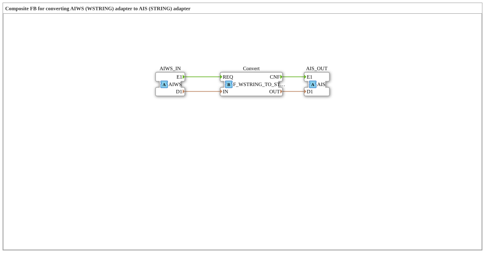

# AIWS_TO_AIS

* * * * * * * * * *

!!! warning "Noch nicht freigegeben"
    Der Baustein ist als Typ in der Bibliothek definiert (Stand 2026-11-13). Die zugehörige Firmware-Seite (C++ und ELF-Bibliotheken) ist noch nicht freigegeben. Bitte noch nicht als lauffähig voraussetzen.

## Einleitung

`AIWS_TO_AIS` ist ein Composite-Baustein: Composite FB for converting AIWS (WSTRING) adapter to AIS (STRING) adapter.

## Schnittstellenstruktur

### **Ereignis-Eingänge**

Keine direkten Ereignisse.

### **Ereignis-Ausgänge**

Keine direkten Ereignisse.

### **Daten-Eingänge**

Keine direkten Daten.

### **Daten-Ausgänge**

Keine direkten Daten.

### **Adapter**

| Rolle | Name | Typ | Beschreibung |
| --- | --- | --- | --- |
| Socket | AIWS_IN | adapter::types::unidirectional::AIWS | WSTRING Adapter Input |
| Plug | AIS_OUT | adapter::types::unidirectional::AIS | STRING Adapter Output |

## Funktionsweise

Die Verbindungen stehen im Abschnitt „Verbindungen im Baustein“. Intern arbeitet `iec61131::conversion::F_WSTRING_TO_STRING`.

## Verbindungen im Baustein

**Interne Bausteine:** `Convert` (`iec61131::conversion::F_WSTRING_TO_STRING`)

**Ereignisverbindungen:**

- `AIWS_IN.E1` → `Convert.REQ`
- `Convert.CNF` → `AIS_OUT.E1`

**Datenverbindungen:**

- `AIWS_IN.D1` → `Convert.IN`
- `Convert.OUT` → `AIS_OUT.D1`

## Technische Besonderheiten

- Initial Version - Luecke in der Adapter-Familie geschlossen

## ⚖️ Vergleich mit ähnlichen Bausteinen

Bausteine derselben Familie liegen im selben Ordner oder in den Nachbarordnern von `conversion`.
