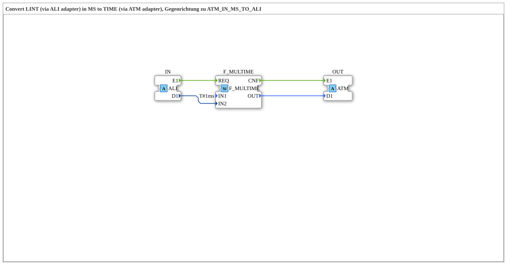

# ALI_TO_ATM_IN_MS

* * * * * * * * * *

!!! warning "Noch nicht freigegeben"
    Der Baustein ist als Typ in der Bibliothek definiert (Stand 2026-11-13). Die zugehörige Firmware-Seite (C++ und ELF-Bibliotheken) ist noch nicht freigegeben. Bitte noch nicht als lauffähig voraussetzen.

## Einleitung

`ALI_TO_ATM_IN_MS` wandelt einen `LINT`-Wert (über den Adapter `ALI`) in einen `TIME`-Wert (über den Adapter `ATM`) um: **TIME = IN × 1 MS** (Einheit Millisekunden). Er ist die Gegenrichtung zu [ATM_IN_MS_TO_ALI](ATM_IN_MS_TO_ALI.md).

## Schnittstellenstruktur

### **Ereignis-Eingänge**

Keine direkten Ereignisse.

### **Ereignis-Ausgänge**

Keine direkten Ereignisse.

### **Daten-Eingänge**

Keine direkten Daten.

### **Daten-Ausgänge**

Keine direkten Daten.

### **Adapter**

| Rolle | Name | Typ | Beschreibung |
| --- | --- | --- | --- |
| Socket | IN | adapter::types::unidirectional::ALI | Zeitwert in MS als LINT |
| Plug | OUT | adapter::types::unidirectional::ATM | TIME-Wert = IN * 1 MS |

## Funktionsweise

Intern multipliziert `F_MULTIME` (`iec61131::arithmetic::F_MULTIME`) den Eingangswert mit einer Einheit. Ereignis und Wert laufen über die Adapter, die Verbindungen stehen im Abschnitt „Verbindungen im Baustein“.

## Verbindungen im Baustein

**Interne Bausteine:** `F_MULTIME` (`iec61131::arithmetic::F_MULTIME`)

**Ereignisverbindungen:**

- `IN.E1` → `F_MULTIME.REQ`
- `F_MULTIME.CNF` → `OUT.E1`

**Datenverbindungen:**

- `IN.D1` → `F_MULTIME.IN2`
- `F_MULTIME.OUT` → `OUT.D1`

## Technische Besonderheiten

- Composite mit einem internen Funktionsbaustein (`F_MULTIME`).
- Der Eingangswert ist in Millisekunden (Typ `LINT`), das Ergebnis ein `TIME`.

## ⚖️ Vergleich mit ähnlichen Bausteinen

- Gleiche Einheit, anderer Eingangstyp: [ADI_TO_ATM_IN_MS](ADI_TO_ATM_IN_MS.md), [ALR_TO_ATM_IN_MS](ALR_TO_ATM_IN_MS.md), [AUDI_TO_ATM_IN_MS](AUDI_TO_ATM_IN_MS.md), [AULI_TO_ATM_IN_MS](AULI_TO_ATM_IN_MS.md).
- Gleicher Typ, andere Einheit: [ALI_TO_ATM_IN_NS](ALI_TO_ATM_IN_NS.md), [ALI_TO_ATM_IN_S](ALI_TO_ATM_IN_S.md), [ALI_TO_ATM_IN_US](ALI_TO_ATM_IN_US.md).
- Gegenrichtung: [ATM_IN_MS_TO_ALI](ATM_IN_MS_TO_ALI.md).
