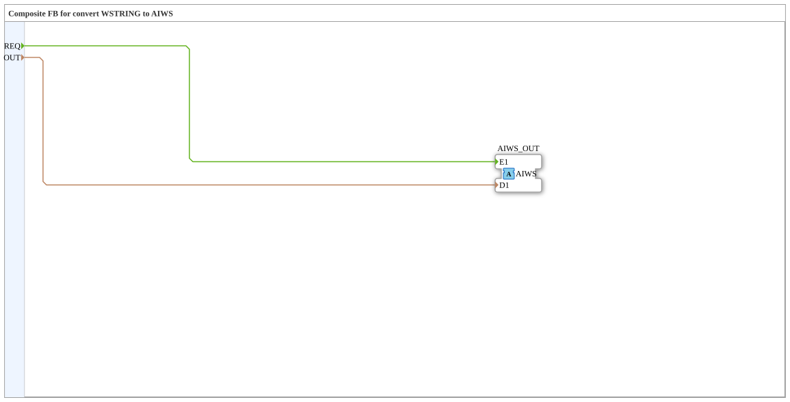

# AIWS_WSTRING_TO_WS

* * * * * * * * * *

!!! warning "Noch nicht freigegeben"
    Der Baustein ist als Typ in der Bibliothek definiert (Stand 2026-11-13). Die zugehörige Firmware-Seite (C++ und ELF-Bibliotheken) ist noch nicht freigegeben. Bitte noch nicht als lauffähig voraussetzen.

## Einleitung

`AIWS_WSTRING_TO_WS` ist ein Composite-Baustein: Composite FB for convert WSTRING to AIWS.

## Schnittstellenstruktur

### **Ereignis-Eingänge**

| Ereignis | Typ | Mit | Beschreibung |
| --- | --- | --- | --- |
| REQ | Event | OUT | Request to Adapter |

### **Ereignis-Ausgänge**

Keine direkten Ereignisse.

### **Daten-Eingänge**

| Name | Typ | Beschreibung |
| --- | --- | --- |
| OUT | WSTRING | Output data to Adapter |

### **Daten-Ausgänge**

Keine direkten Daten.

### **Adapter**

| Rolle | Name | Typ | Beschreibung |
| --- | --- | --- | --- |
| Plug | AIWS_OUT | adapter::types::unidirectional::AIWS | Adapter Output |

## Funktionsweise

Die Verbindungen stehen im Abschnitt „Verbindungen im Baustein“. Es gibt keine internen Funktionsbausteine, der Baustein verdrahtet nur Adapter und Ein-/Ausgänge.

## Verbindungen im Baustein

**Ereignisverbindungen:**

- `REQ` → `AIWS_OUT.E1`

**Datenverbindungen:**

- `OUT` → `AIWS_OUT.D1`

## Technische Besonderheiten

- Initial Version - Luecke geschlossen (analog zu AB_BYTE_TO_B)

## ⚖️ Vergleich mit ähnlichen Bausteinen

Bausteine derselben Familie liegen im selben Ordner oder in den Nachbarordnern von `conversion`.
