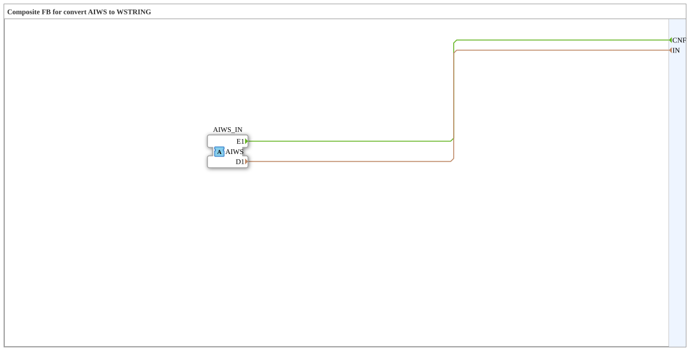

# AIWS_WS_TO_WSTRING

* * * * * * * * * *

!!! warning "Noch nicht freigegeben"
    Der Baustein ist als Typ in der Bibliothek definiert (Stand 2026-11-13). Die zugehörige Firmware-Seite (C++ und ELF-Bibliotheken) ist noch nicht freigegeben. Bitte noch nicht als lauffähig voraussetzen.

## Einleitung

`AIWS_WS_TO_WSTRING` ist ein Composite-Baustein: Composite FB for convert AIWS to WSTRING.

## Schnittstellenstruktur

### **Ereignis-Eingänge**

Keine direkten Ereignisse.

### **Ereignis-Ausgänge**

| Ereignis | Typ | Mit | Beschreibung |
| --- | --- | --- | --- |
| CNF | Event | IN | Confirmation from Adapter |

### **Daten-Eingänge**

Keine direkten Daten.

### **Daten-Ausgänge**

| Name | Typ | Beschreibung |
| --- | --- | --- |
| IN | WSTRING | Input data from Adapter |

### **Adapter**

| Rolle | Name | Typ | Beschreibung |
| --- | --- | --- | --- |
| Socket | AIWS_IN | adapter::types::unidirectional::AIWS | Adapter Input |

## Funktionsweise

Die Verbindungen stehen im Abschnitt „Verbindungen im Baustein“. Es gibt keine internen Funktionsbausteine, der Baustein verdrahtet nur Adapter und Ein-/Ausgänge.

## Verbindungen im Baustein

**Ereignisverbindungen:**

- `AIWS_IN.E1` → `CNF`

**Datenverbindungen:**

- `AIWS_IN.D1` → `IN`

## Technische Besonderheiten

- Initial Version - Luecke geschlossen (analog zu AB_B_TO_BYTE)

## ⚖️ Vergleich mit ähnlichen Bausteinen

Bausteine derselben Familie liegen im selben Ordner oder in den Nachbarordnern von `conversion`.
