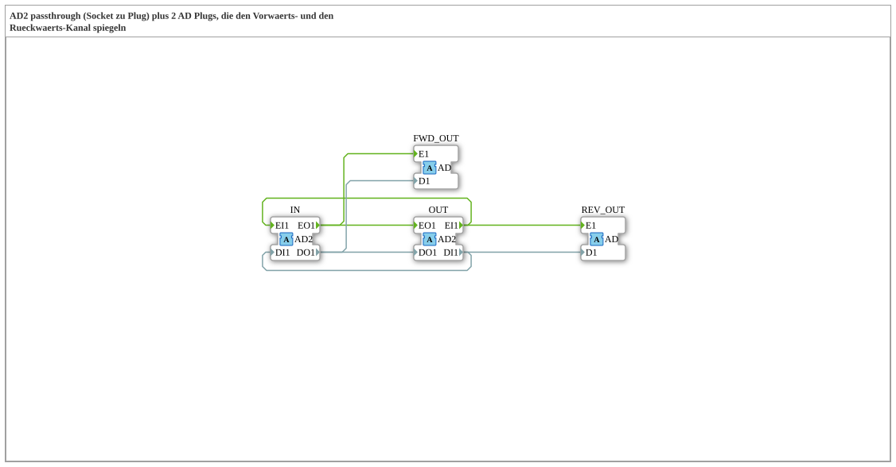

# AD2_SPLIT_FWD_REV

* * * * * * * * * *

!!! warning "Noch nicht freigegeben"
    Der Baustein ist als Typ in der Bibliothek definiert (Stand 2026-11-13). Die zugehörige Firmware-Seite (C++ und ELF-Bibliotheken) ist noch nicht freigegeben. Bitte noch nicht als lauffähig voraussetzen.

## Einleitung

`AD2_SPLIT_FWD_REV` reicht den bidirektionalen Adapter `AD2` von `IN` nach `OUT` durch (Passthrough) und spiegelt zusätzlich den **Vorwärtskanal** auf `FWD_OUT` und den **Rückwärtskanal** auf `REV_OUT`. Beide Spiegel sind unidirektionale `AD`-Adapter.

## Schnittstellenstruktur

### **Ereignis-Eingänge**

Keine direkten Ereignisse.

### **Ereignis-Ausgänge**

Keine direkten Ereignisse.

### **Daten-Eingänge**

Keine direkten Daten.

### **Daten-Ausgänge**

Keine direkten Daten.

### **Adapter**

| Rolle | Name | Typ | Beschreibung |
| --- | --- | --- | --- |
| Socket | IN | adapter::types::bidirectional::AD2 | bidirektionaler Eingang |
| Plug | OUT | adapter::types::bidirectional::AD2 | bidirektionaler Ausgang (Passthrough) |
| Plug | FWD_OUT | adapter::types::unidirectional::AD | spiegelt den Vorwaerts-Kanal (IN.EO1/DO1) |
| Plug | REV_OUT | adapter::types::unidirectional::AD | spiegelt den Rueckwaerts-Kanal (OUT.EI1/DI1) |

## Funktionsweise

Alle Verbindungen sind direkte Ereignis- und Datenverbindungen, es gibt keine eigene Logik. Die Liste steht im Abschnitt „Verbindungen im Baustein“.

## Verbindungen im Baustein

**Ereignisverbindungen:**

- `IN.EO1` → `OUT.EO1`
- `IN.EO1` → `FWD_OUT.E1`
- `OUT.EI1` → `IN.EI1`
- `OUT.EI1` → `REV_OUT.E1`

**Datenverbindungen:**

- `IN.DO1` → `OUT.DO1`
- `IN.DO1` → `FWD_OUT.D1`
- `OUT.DI1` → `IN.DI1`
- `OUT.DI1` → `REV_OUT.D1`

## Technische Besonderheiten

- Reiner Verdrahtungsbaustein (Composite ohne interne Funktionsbausteine).
- Der Spiegel dient zum Abgreifen eines Kanals, ohne den Passthrough zu stören.

## ⚖️ Vergleich mit ähnlichen Bausteinen

- Gleiche Familie: [AB2_SPLIT_FWD_REV](../AB2_SPLIT_FWD_REV.md) und weitere im übergeordneten Ordner.
