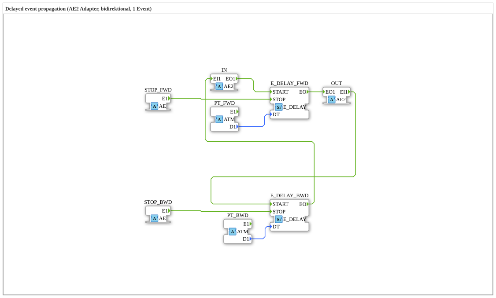

# AE2_DELAY

* * * * * * * * * *

## Einleitung

Der Funktionsblock `AE2_DELAY` verzögert Ereignisse eines bidirektionalen [`AE2`](../../types/bidirectional/EVENT/AE2.md)-Adapters. Weil AE2 in beide Richtungen Ereignisse führt (`EO1` vorwärts, `EI1` rückwärts), besitzt der Baustein zwei voneinander unabhängige Verzögerungsstrecken: eine für die Vorwärts-Richtung (`IN` → `OUT`) mit der Zeit `PT_FWD` und eine für die Rückwärts-Richtung (`OUT` → `IN`) mit der Zeit `PT_BWD`. Jede Richtung kann über einen eigenen `STOP`-Socket abgebrochen werden.

## Schnittstellenstruktur

### **Ereignis-Eingänge**

Der Funktionsblock verfügt über keine direkten Ereignis-Eingänge.

### **Ereignis-Ausgänge**

Der Funktionsblock verfügt über keine direkten Ereignis-Ausgänge.

### **Daten-Eingänge**

Der Funktionsblock verfügt über keine direkten Daten-Eingänge.

### **Daten-Ausgänge**

Der Funktionsblock verfügt über keine direkten Daten-Ausgänge.

### **Adapter**

- **IN** (Socket): Ereignis vom vorherigen Kettenglied (vorwärts herein, rückwärts hinaus), Typ `adapter::types::bidirectional::AE2`
- **OUT** (Plug): verzögertes Ereignis an das nächste Kettenglied (vorwärts hinaus, rückwärts herein), Typ `adapter::types::bidirectional::AE2`
- **STOP_FWD** (Socket): bricht die laufende Vorwärts-Verzögerung ab, Typ `adapter::types::unidirectional::AE`
- **PT_FWD** (Socket): Verzögerungszeit (Preset Time) Vorwärts, Typ `adapter::types::unidirectional::ATM`
- **STOP_BWD** (Socket): bricht die laufende Rückwärts-Verzögerung ab, Typ `adapter::types::unidirectional::AE`
- **PT_BWD** (Socket): Verzögerungszeit Rückwärts, unabhängig von `PT_FWD` einstellbar, Typ `adapter::types::unidirectional::ATM`

## Funktionsweise

Das interne Netzwerk besteht aus zwei Instanzen von [`E_DELAY`](../../../../StandardLibraries/events/E_DELAY.md):

- **Vorwärts** (`E_DELAY_FWD`): `IN.EO1` → `E_DELAY_FWD.START`, `STOP_FWD.E1` → `E_DELAY_FWD.STOP`, `PT_FWD.D1` → `E_DELAY_FWD.DT`. Nach Ablauf der Zeit wird `E_DELAY_FWD.EO` auf `OUT.EO1` ausgegeben.
- **Rückwärts** (`E_DELAY_BWD`): `OUT.EI1` → `E_DELAY_BWD.START`, `STOP_BWD.E1` → `E_DELAY_BWD.STOP`, `PT_BWD.D1` → `E_DELAY_BWD.DT`. Nach Ablauf der Zeit wird `E_DELAY_BWD.EO` auf `IN.EI1` ausgegeben.

Die Daten des Adapters werden nicht verarbeitet; es werden ausschließlich die Ereignisse `EO1`/`EI1` weitergereicht.

## Technische Besonderheiten

- Zwei unabhängige Verzögerungsstrecken (je Richtung eine `E_DELAY`-Instanz) mit eigener Zeit und eigenem `STOP`
- Die Zeiten werden über `ATM`-Sockets statt über Klartext-Eingangsvariablen geliefert und lassen sich dadurch sauber über `initval_ATM` (mit `INIT`/`INITO`) initialisieren
- Der Socket für die Zeit heißt `PT` (Preset Time) und nicht `DT`, weil `DT` in IEC 61131-3 ein reserviertes Schlüsselwort (`DATE_AND_TIME`) ist
- Der Baustein selbst ist zustandslos; der Zustand (laufender Timer) liegt in den beiden `E_DELAY`-Instanzen

## Anwendungsszenarien

- Zeitversetztes Weiterreichen von Ereignissen in einer AE2-Kette, z. B. gestaffeltes Einschalten und Ausschalten mit unterschiedlichen Zeiten
- Entkopplung von Anforderung und Rückmeldung in bidirektionalen Ereignisketten

## ⚖️ Vergleich mit ähnlichen Bausteinen

Für Ketten mit getrennt verzögertem Set- und Reset-Zweig gibt es `ASR2_DELAY`, dessen Variante mit fest vorbelegten Zeiten [`ASR2_DELAY_SUB`](../../../MyLib_AX/sys/ASR2_DELAY_SUB.md) ist. `AE2_DELAY` verzögert dagegen genau ein Ereignis je Richtung.

## Fazit

`AE2_DELAY` ist ein reiner Verdrahtungsbaustein aus zwei `E_DELAY`-Instanzen, der Ereignisse eines AE2-Adapters in beiden Richtungen mit je einer eigenen, per `ATM`-Socket einstellbaren Zeit verzögert und je Richtung stoppbar ist.
