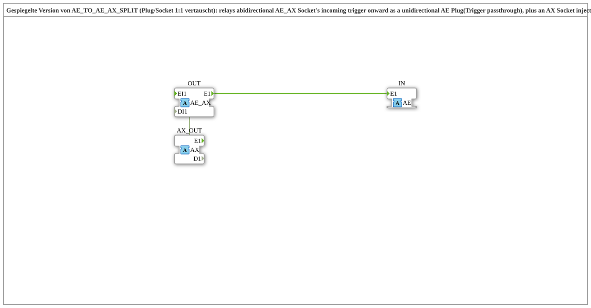

# AE_AX_TO_AE_SPLIT

* * * * * * * * * *

## Einleitung

`AE_AX_TO_AE_SPLIT` ist die gespiegelte Version von `AE_TO_AE_AX_SPLIT` (Plug und Socket 1:1 vertauscht). Der Baustein leitet das eingehende Trigger-Ereignis eines bidirektionalen `AE_AX`-Sockets als unidirektionalen `AE`-Plug weiter (Trigger-Durchreichung) und speist über einen zusätzlichen `AX`-Socket einen extern gelieferten Wert in den Rückkanal (Zustand) des `AE_AX`-Sockets ein.

## Schnittstellenstruktur

### **Ereignis-Eingänge / -Ausgänge**

Keine eigenen Ereignis- oder Datenanschlüsse; alle Ereignisse und Daten laufen über die Adapter.

### **Adapter**

| Richtung | Name | Adaptertyp | Kommentar |
| :--- | :--- | :--- | :--- |
| **Plug** (Ausgang) | `IN` | `adapter::types::unidirectional::AE` | Ausgang (Trigger, unidirektional). |
| **Socket** (Eingang) | `OUT` | `adapter::types::bidirectional::AE_AX` | Eingang (Trigger rein, Zustand raus). |
| **Socket** (Eingang) | `AX_OUT` | `adapter::types::unidirectional::AX` | Speist den Rückkanal (Zustand) des `AE_AX` ein. |

## Funktionsweise

Der Baustein ist ein Composite-FB ohne eigene Funktionsbausteine, er besteht nur aus Adapter-Verbindungen:

- **Ereignisverbindungen:** `OUT.E1` → `IN.E1` (das am `AE_AX`-Socket eingehende Ereignis wird unverändert am `AE`-Plug ausgegeben); `AX_OUT.E1` → `OUT.EI1` (das am `AX`-Socket empfangene Ereignis wird als Rückkanal-Ereignis über den `AE_AX`-Socket ausgegeben).
- **Datenverbindung:** `AX_OUT.D1` → `OUT.DI1` (der am `AX`-Socket empfangene Wert wird als Rückkanal-Datum `DI1` des `AE_AX`-Sockets ausgegeben).

## Technische Besonderheiten

- Reine Verdrahtung, keine Logik und keine Verzögerung.
- Die Namen `IN`/`OUT` sind aus Sicht der Quelle `AE_TO_AE_AX_SPLIT` übernommen und deshalb vertauscht: `OUT` ist hier ein Socket, `IN` ein Plug.
- Die Richtung der Trigger bleibt unidirektional (`AE`), der Rückkanal wird vollständig vom `AX`-Socket gespeist.

## Anwendungsszenarien

- Einen bidirektionalen `AE_AX`-Anschluss in einen reinen Trigger-Pfad (`AE`) und einen separat gespeisten Zustandspfad (`AX`) aufspalten.

## Zusammenfassung

`AE_AX_TO_AE_SPLIT` trennt einen `AE_AX`-Socket in einen weitergereichten `AE`-Trigger und einen über `AX` gespeisten Rückkanal.

---

### 🌐 Passende Themen-Unterseiten auf ms-muc-docs.de

- [🌐 Eclipse 4diac IDE & Farb-Referenz auf ms-muc-docs.de](https://www.ms-muc-docs.de/iec-61499/eclipse-4diac/)
