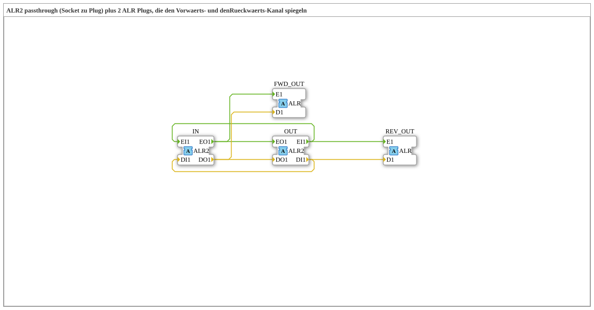

# ALR2_SPLIT_FWD_REV

* * * * * * * * * *

## Einleitung

`ALR2_SPLIT_FWD_REV` ist ein Composite-Funktionsblock, der einen bidirektionalen `ALR2`-Adapter vom Socket `IN` unverändert zum Plug `OUT` durchreicht (Passthrough) und zusätzlich den Vorwärts- und den Rückwärts-Kanal auf zwei getrennte, unidirektionale `ALR`-Plugs spiegelt. So können beide Richtungen einer `ALR2`-Verbindung an weiteren Stellen mitgelesen werden, ohne die Verbindung selbst zu verändern.

## Schnittstellenstruktur

### **Ereignis-Eingänge**

*Keine direkten Ereignis-Eingänge vorhanden – Ereignisse kommen über die Adapter-Sockets/-Plugs*

### **Ereignis-Ausgänge**

*Keine direkten Ereignis-Ausgänge vorhanden*

### **Daten-Eingänge**

*Keine Daten-Eingänge vorhanden*

### **Daten-Ausgänge**

*Keine Daten-Ausgänge vorhanden*

### **Adapter**

- **IN** (Socket): Bidirektionaler Adapter vom Typ `adapter::types::bidirectional::ALR2` (bidirektionaler Eingang)
- **OUT** (Plug): Bidirektionaler Adapter vom Typ `adapter::types::bidirectional::ALR2` (bidirektionaler Ausgang, Passthrough)
- **FWD_OUT** (Plug): Unidirektionaler Adapter vom Typ `adapter::types::unidirectional::ALR`, spiegelt den Vorwärts-Kanal (`IN.EO1`/`DO1`)
- **REV_OUT** (Plug): Unidirektionaler Adapter vom Typ `adapter::types::unidirectional::ALR`, spiegelt den Rückwärts-Kanal (`OUT.EI1`/`DI1`)

## Funktionsweise

1. **Vorwärts (Indikation)**: `IN.EO1`/`IN.DO1` wird unverändert an `OUT.EO1`/`OUT.DO1` weitergeleitet und zusätzlich an `FWD_OUT.E1`/`FWD_OUT.D1` gespiegelt.
2. **Rückwärts (Request)**: `OUT.EI1`/`OUT.DI1` wird unverändert an `IN.EI1`/`IN.DI1` weitergeleitet und zusätzlich an `REV_OUT.E1`/`REV_OUT.D1` gespiegelt.

## Technische Besonderheiten

- Reine Ereignis-/Datenverbindungen (`FBNetwork`), keine eigene Logik und kein interner Zustand
- Jeder Ereignis-Ausgang des Passthrough speist zwei Ziele (Fan-out), die Daten laufen parallel zu den Ereignissen
- Die beiden Spiegel-Plugs sind unidirektional (`ALR`) und liefern daher nur Lesezugriff auf den jeweiligen Kanal

## Anwendungsszenarien

- Mitlesen (Monitoring/Diagnose) beider Richtungen einer bidirektionalen `ALR2`-Verbindung
- Aufteilen einer `ALR2`-Verbindung in einen separat auswertbaren Vorwärts- und Rückwärtsstrom, ohne die Hauptverbindung zu unterbrechen

## Fazit

`ALR2_SPLIT_FWD_REV` reicht eine bidirektionale `ALR2`-Verbindung transparent durch und stellt Vorwärts- und Rückwärts-Kanal zusätzlich als getrennte `ALR`-Adapter zur Verfügung.
