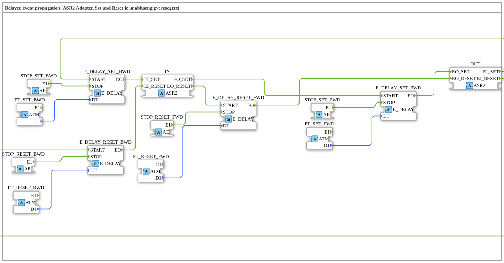

# ASR2_DELAY

* * * * * * * * * *

## Einleitung

`ASR2_DELAY` ist ein Composite-Funktionsblock, der die Set-/Reset-Ereignisse eines bidirektionalen `ASR2`-Adapters **verzögert** weiterreicht (z. B. für gestaffeltes Ein-/Ausschalten mehrerer Bänder mit [`AX_T_FF_SR_SEQ`](../unidirectional/BOOL/AX_T_FF_SR_SEQ.md)). Da `ASR2` echt bidirektional ist (`EI_SET`/`EI_RESET`/`EO_SET`/`EO_RESET`), werden **vier unabhängige** [`E_DELAY`](../../../../StandardLibraries/events/E_DELAY.md)-Instanzen verwendet: Set und Reset je in Vorwärts- und Rückwärts-Richtung, jeweils mit eigener Zeit und eigenem Stop-Eingang.

## Schnittstellenstruktur

### **Ereignis-Eingänge**

*Keine direkten Ereignis-Eingänge vorhanden – Ereignisse kommen über die Adapter-Sockets/-Plugs*

### **Ereignis-Ausgänge**

*Keine direkten Ereignis-Ausgänge vorhanden*

### **Daten-Eingänge**

*Keine Daten-Eingänge vorhanden – die Zeiten kommen über `ATM`-Sockets*

### **Daten-Ausgänge**

*Keine Daten-Ausgänge vorhanden*

### **Adapter**

- **IN** (Socket): `adapter::types::bidirectional::ASR2` – Set/Reset vom vorherigen Kettenglied (vorwärts herein, rückwärts hinaus)
- **OUT** (Plug): `adapter::types::bidirectional::ASR2` – verzögertes Set/Reset an das nächste Kettenglied (vorwärts hinaus, rückwärts herein)
- **PT_SET_FWD** (Socket, `adapter::types::unidirectional::ATM`): Verzögerungszeit SET vorwärts (`IN.EO_SET` → `OUT.EO_SET`)
- **PT_SET_BWD** (Socket, `ATM`): Verzögerungszeit SET rückwärts (`OUT.EI_SET` → `IN.EI_SET`)
- **PT_RESET_FWD** (Socket, `ATM`): Verzögerungszeit RESET vorwärts (`IN.EO_RESET` → `OUT.EO_RESET`)
- **PT_RESET_BWD** (Socket, `ATM`): Verzögerungszeit RESET rückwärts (`OUT.EI_RESET` → `IN.EI_RESET`)
- **STOP_SET_FWD**, **STOP_SET_BWD**, **STOP_RESET_FWD**, **STOP_RESET_BWD** (Sockets, `adapter::types::unidirectional::AE`): Stoppen der jeweiligen Verzögerung

## Verwendete Funktionsbausteine (FBs)

- **E_DELAY_SET_FWD**, **E_DELAY_SET_BWD**, **E_DELAY_RESET_FWD**, **E_DELAY_RESET_BWD**: je `iec61499::events::E_DELAY`

## Funktionsweise

| Pfad | START | STOP | Zeit (`DT`) | Ausgang |
| --- | --- | --- | --- | --- |
| SET vorwärts | `IN.EO_SET` | `STOP_SET_FWD.E1` | `PT_SET_FWD.D1` | `OUT.EO_SET` |
| SET rückwärts | `OUT.EI_SET` | `STOP_SET_BWD.E1` | `PT_SET_BWD.D1` | `IN.EI_SET` |
| RESET vorwärts | `IN.EO_RESET` | `STOP_RESET_FWD.E1` | `PT_RESET_FWD.D1` | `OUT.EO_RESET` |
| RESET rückwärts | `OUT.EI_RESET` | `STOP_RESET_BWD.E1` | `PT_RESET_BWD.D1` | `IN.EI_RESET` |

Jedes eintreffende Ereignis startet die zugehörige `E_DELAY`-Instanz; nach Ablauf der Zeit wird das Ereignis am Ausgang ausgelöst, sofern die Verzögerung nicht vorher über den Stop-Socket gestoppt wurde.

## Technische Besonderheiten

- Die vier Zeiten sind über `ATM`-Sockets bereitgestellt und damit unabhängig voneinander einstellbar sowie über `initval_ATM` mit `INIT`/`INITO` initialisierbar (Version 1.1/1.2). Die Bezeichner tragen das Präfix `PT` statt `DT`, da `DT` ein reserviertes Schlüsselwort ist.
- Seit Version 1.2 werden beide Richtungen verzögert (vorher nur vorwärts).

## Anwendungsszenarien

- Gestaffeltes Ein-/Ausschalten hintereinander geschalteter Förderbänder über eine `AX_T_FF_SR_SEQ`-Kette

## Fazit

`ASR2_DELAY` verzögert Set und Reset eines `ASR2`-Kettenglieds in beiden Richtungen mit vier getrennt einstellbaren Zeiten und vier Stop-Eingängen.
