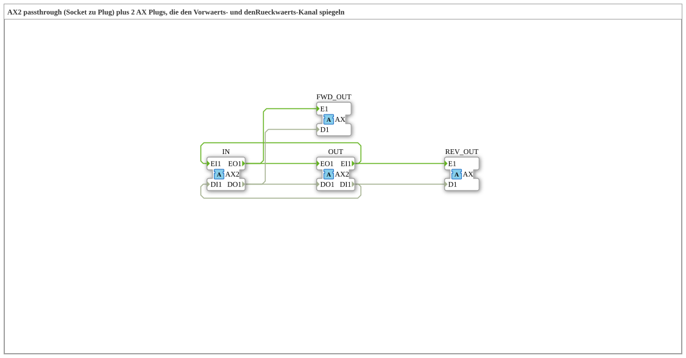

# AX2_SPLIT_FWD_REV

* * * * * * * * * *

## Einleitung

Der Funktionsblock `AX2_SPLIT_FWD_REV` führt einen bidirektionalen [`AX2`](../../types/bidirectional/BOOL/AX2.md)-Adapter unverändert von `IN` (Socket) nach `OUT` (Plug) durch und spiegelt dabei zusätzlich beide Kanäle auf je einen unidirektionalen [`AX`](../../types/unidirectional/BOOL/AX.md)-Plug: den Vorwärts-Kanal (Indikation, `IN.EO1`/`DO1`) auf `FWD_OUT` und den Rückwärts-Kanal (Request, `OUT.EI1`/`DI1`) auf `REV_OUT`. Damit lassen sich beide Richtungen einer bidirektionalen AX2-Verbindung getrennt als einfache AX-Signale abgreifen.

## Schnittstellenstruktur

### **Ereignis-Eingänge**

Der Funktionsblock verfügt über keine direkten Ereignis-Eingänge.

### **Ereignis-Ausgänge**

Der Funktionsblock verfügt über keine direkten Ereignis-Ausgänge.

### **Daten-Eingänge**

Der Funktionsblock verfügt über keine direkten Daten-Eingänge.

### **Daten-Ausgänge**

Der Funktionsblock verfügt über keine direkten Daten-Ausgänge.

### **Adapter**

- **IN** (Socket): bidirektionaler Eingang, Typ `adapter::types::bidirectional::AX2`
- **OUT** (Plug): bidirektionaler Ausgang (Passthrough), Typ `adapter::types::bidirectional::AX2`
- **FWD_OUT** (Plug): spiegelt den Vorwärts-Kanal (`IN.EO1`/`DO1`), Typ `adapter::types::unidirectional::AX`
- **REV_OUT** (Plug): spiegelt den Rückwärts-Kanal (`OUT.EI1`/`DI1`), Typ `adapter::types::unidirectional::AX`

## Funktionsweise

Der Baustein besteht nur aus Verdrahtung:

- **Vorwärts** (Indikation): `IN.EO1` → `OUT.EO1` und zusätzlich `IN.EO1` → `FWD_OUT.E1`; `IN.DO1` → `OUT.DO1` und zusätzlich `IN.DO1` → `FWD_OUT.D1`.
- **Rückwärts** (Request): `OUT.EI1` → `IN.EI1` und zusätzlich `OUT.EI1` → `REV_OUT.E1`; `OUT.DI1` → `IN.DI1` und zusätzlich `OUT.DI1` → `REV_OUT.D1`.

Beide Richtungen laufen also unverändert durch, und jede wird zusätzlich als einfaches unidirektionales AX-Signal ausgegeben.

## Technische Besonderheiten

- Reine Verdrahtung ohne Logik oder Zustand
- Der Passthrough `IN` → `OUT` bleibt vollständig erhalten; `FWD_OUT` und `REV_OUT` sind reine Beobachtungs-Abzweige
- Die Quellen werden jeweils auf zwei Ziele verzweigt (Ereignis und Daten); das Verhalten entspricht dem eines Splits auf beide Zweige

## Anwendungsszenarien

- Mitlesen der Vorwärts- und der Rückwärts-Richtung einer AX2-Verbindung (z. B. für Anzeige, Logging oder Diagnose), ohne die Verbindung selbst zu verändern
- Getrennte Weiterverarbeitung von Indikation und Request als einfache AX-Signale

## ⚖️ Vergleich mit ähnlichen Bausteinen

Dieselbe Struktur existiert für weitere bidirektionale Adapter, z. B. `AR2_SPLIT_FWD_REV`, `AS2_SPLIT_FWD_REV`, `AX2_SPLIT_FWD_REV`, `AIS2_SPLIT_FWD_REV` und `ALR2_SPLIT_FWD_REV`; sie unterscheiden sich nur im Datentyp des Adapters.

## Fazit

`AX2_SPLIT_FWD_REV` ist ein zustandsloser Passthrough für AX2, der Vorwärts- und Rückwärts-Kanal zusätzlich auf zwei unidirektionale AX-Plugs spiegelt.
