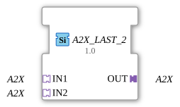

# A2X_LAST_2

## Einleitung

Der Funktionsblock `A2X_LAST_2` führt 2 gleichartige `A2X`-Adapter-Signale (**IN1** bis **IN2**) auf einen gemeinsamen Ausgang (**OUT**) zusammen, nach dem Prinzip **Last Writer Wins**, getrennt für die Kanäle UP und DOWN: Auf jedem Kanal gewinnt der Socket, der zuletzt ein Ereignis gesendet hat, und sein Wert wird sofort an OUT durchgereicht.

## Schnittstellenstruktur

### **Adapter**

**Eingangsadapter (Sockets):**

- **IN1**: A2X-Adapter (unidirectional)
- **IN2**: A2X-Adapter (unidirectional)

**Ausgangsadapter (Plug):**

- **OUT**: A2X-Adapter (unidirectional), zusammengeführtes Signal

## Funktionsweise

Der Socket mit dem letzten Ereignis gewinnt, getrennt für UP und DOWN: Die beiden Kanäle laufen unabhängig voneinander. OUT übernimmt sofort den Wert des Gewinners und sendet das Ereignis, auch wenn der Wert gleich bleibt.

## Technische Besonderheiten

- Generischer Funktionsblock ohne ECC (`GenericClassName` = `GEN_A2X_LAST`); das Verhalten ist in der Firmware (FORTE) umgesetzt, die Typbeschreibung enthält keinen Algorithmus. Bis Version 1.0 war `A2X_LAST_2` ein Basic-FB mit ECC; Version 1.1 ist generisch, die Schnittstelle bleibt gleich.
- Schnittstelle: Sockets `IN1` und `IN2`, Plug `OUT`.
- Alle Größen `A2X_LAST_2` bis `A2X_LAST_9` haben dieselbe Funktion und unterscheiden sich nur in der Zahl der Sockets.
- Stand: Laut Entwicklung ist `AD_LAST_3` auf Hardware getestet (Trainer20, ESP32-S31); die übrigen Typen und Größen sind es nicht.

## Anwendungsszenarien

- Zusammenführen gleichwertiger Signalquellen zu einem nachgeschalteten Adapterpfad, zum Beispiel ein manueller und ein automatischer Sollwertgeber.
- Arbitrierung zwischen mehreren Bedienstellen, die denselben Wert schreiben dürfen.
- Vereinfachung von Netzwerken, die sonst `F_SEL`/`E_RS` inline verdrahten müssten.
