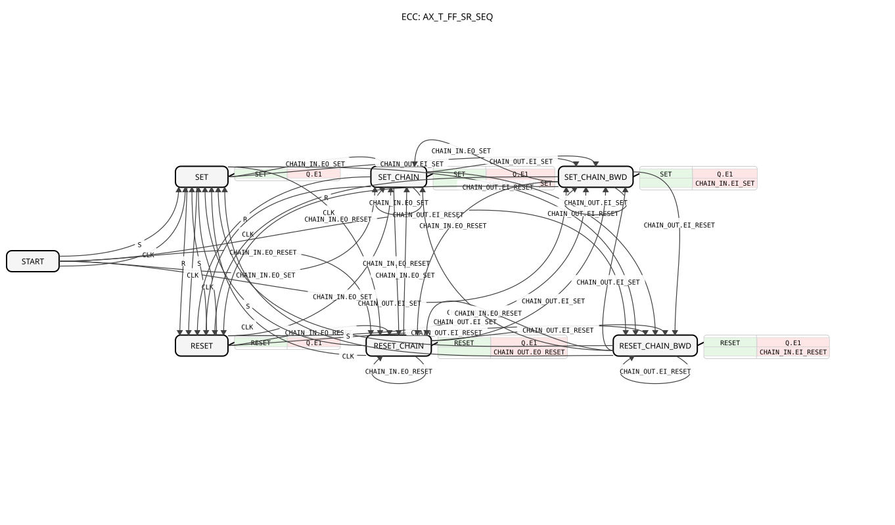

# AX_T_FF_SR_SEQ

* * * * * * * * * *

## Einleitung

`AX_T_FF_SR_SEQ` ist ein ereignisgesteuertes bistabiles Flipflop mit Toggle-Funktion (Kopie von `AX_T_FF_SR`), das zusätzlich **echt bidirektional kettenfähig** über den Adapter `ASR2` (`CHAIN_IN`/`CHAIN_OUT`) ist. Damit lassen sich mehrere Bänder gestaffelt ein- und ausschalten (z. B. zusammen mit [`ASR2_DELAY`](../../bidirectional/ASR2_DELAY.md)). Die lokalen Ereignisse `S`/`R`/`CLK` verhalten sich exakt wie bei `AX_T_FF_SR` und lösen **nie** `CHAIN_IN`/`CHAIN_OUT` aus.

## Schnittstellenstruktur

### **Ereignis-Eingänge**

- **S**: Setzt den Ausgang `Q` (lokal, wirkt nie auf `CHAIN_IN`/`CHAIN_OUT`)
- **R**: Setzt den Ausgang `Q` zurück (lokal, wirkt nie auf `CHAIN_IN`/`CHAIN_OUT`)
- **CLK**: Takt zum Umschalten (Toggle) des Ausgangs (lokal, wirkt nie auf `CHAIN_IN`/`CHAIN_OUT`)

### **Ereignis-Ausgänge**

*Keine direkten Ereignis-Ausgänge vorhanden – Ereignisse laufen über die Adapter-Plugs*

### **Daten-Eingänge**

*Keine Daten-Eingänge vorhanden*

### **Daten-Ausgänge**

*Keine Daten-Ausgänge vorhanden – der Zustand wird über den Adapter `Q` ausgegeben*

### **Adapter**

- **Q** (Plug): Unidirektionaler Adapter vom Typ `adapter::types::unidirectional::AX` – Wert des Flipflops
- **CHAIN_IN** (Socket): Bidirektionaler Adapter vom Typ `adapter::types::bidirectional::ASR2` – vorwärts: Set/Reset vom vorherigen Kettenglied empfangen (`EO_SET`/`EO_RESET`); rückwärts: Set/Reset an das vorherige Kettenglied weiterreichen (`EI_SET`/`EI_RESET`)
- **CHAIN_OUT** (Plug): Bidirektionaler Adapter vom Typ `adapter::types::bidirectional::ASR2` – vorwärts: Set/Reset an das nächste Kettenglied weiterreichen (`EO_SET`/`EO_RESET`); rückwärts: Set/Reset vom nächsten Kettenglied empfangen (`EI_SET`/`EI_RESET`)

## Funktionsweise

Der Baustein besitzt sieben Zustände (`START`, `SET`, `RESET`, `SET_CHAIN`, `RESET_CHAIN`, `SET_CHAIN_BWD`, `RESET_CHAIN_BWD`). Der Ausgang `Q` wird bei jedem Eintritt in einen Setz-Zustand per Algorithmus `SET` auf `TRUE` und in einem Rücksetz-Zustand per `RESET` auf `FALSE` gesetzt und über `Q.E1` ausgegeben.

Es gibt **vier strikt getrennte, nicht verzweigende Kettenpfade**:

1. `CHAIN_IN.EO_SET` → lokal `SET` + `CHAIN_OUT.EO_SET` (Vorwärts-Set)
2. `CHAIN_IN.EO_RESET` → lokal `RESET` + `CHAIN_OUT.EO_RESET` (Vorwärts-Reset)
3. `CHAIN_OUT.EI_SET` → lokal `SET` + `CHAIN_IN.EI_SET` (Rückwärts-Set)
4. `CHAIN_OUT.EI_RESET` → lokal `RESET` + `CHAIN_IN.EI_RESET` (Rückwärts-Reset)

Ein über Pfad 1 ankommendes Set löst niemals zusätzlich Pfad 3 oder 4 aus und umgekehrt – jeder Zustand feuert genau eine Chain-Aktion. Lokal gilt:

- `S` bzw. `CLK` in `START` oder `RESET`/`RESET_CHAIN`/`RESET_CHAIN_BWD` → `SET`
- `R` bzw. `CLK` in `SET`/`SET_CHAIN`/`SET_CHAIN_BWD` → `RESET`
- Die vier Chain-Ereignisse sind aus jedem Zustand heraus möglich und führen in den jeweiligen Chain-Zustand.

## Technische Besonderheiten

- Lokales `S`/`R`/`CLK` verändert nur `Q`, die Kette wird nicht angestoßen.
- Mit den Rückwärtspfaden (Version 1.1) lassen sich dieselben physischen Kettenglieder vorwärts (z. B. Set, Downstream zuerst) und rückwärts (z. B. Reset, Upstream zuerst) gestaffelt schalten, ohne dass ein Vorwärts-Ereignis auch rückwärts weiterläuft oder umgekehrt.
- Ein `R` im Zustand `START` bleibt wirkungslos, da von dort keine Transition mit `R` existiert.

## Anwendungsszenarien

- Gestaffeltes Ein-/Ausschalten mehrerer Förderbänder (z. B. Igelband, Elevator, Querband) mit Verzögerung über [`ASR2_DELAY`](../../bidirectional/ASR2_DELAY.md)

## Fazit

`AX_T_FF_SR_SEQ` erweitert das Set/Reset/Toggle-Flipflop um vier getrennte Kettenpfade (vorwärts/rückwärts, Set/Reset) für kaskadierte, gestaffelte Schaltvorgänge.
