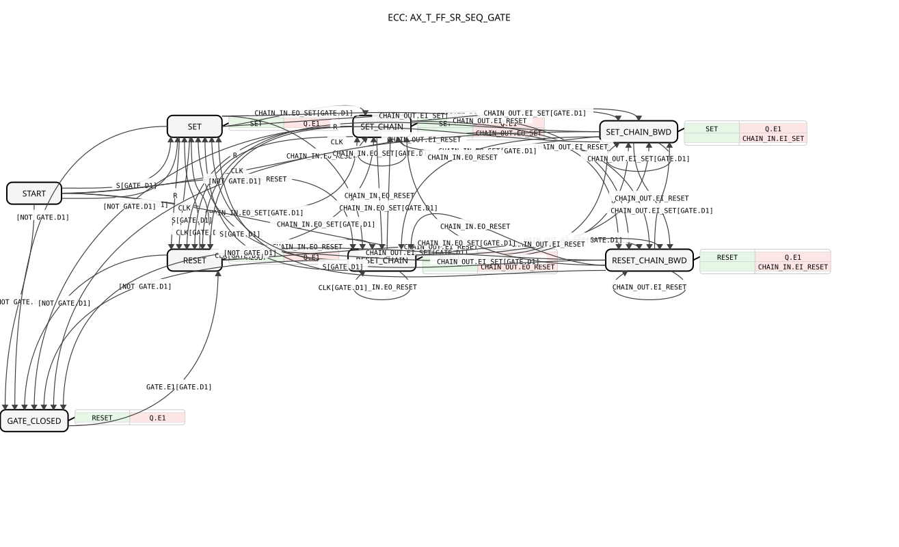

# AX_T_FF_SR_SEQ_GATE

* * * * * * * * * *

## Einleitung

Der `AX_T_FF_SR_SEQ_GATE` ist ein Toggle-/Set-/Reset-Flipflop mit bidirektionaler Ketten-Weitergabe, wie `AX_T_FF_SR_SEQ`, und zusätzlich mit einem Freigabe-Socket `GATE` (Typ `AX`) und einem eigenen Zustand `GATE_CLOSED`. Solange `GATE` TRUE ist, arbeitet der Baustein normal. Fällt `GATE` auf FALSE, wird sofort zwangsweise ein RESET ausgeführt und der Baustein gesperrt; der einzige Ausweg aus `GATE_CLOSED` ist `GATE.E1[GATE.D1]`, also das Wiederöffnen des Gates.

## Schnittstellenstruktur

### **Ereignis-Eingänge**

- **S**: setzt den Ausgang `Q` (lokal, wirkt nie auf `CHAIN_IN`/`CHAIN_OUT`); wirkungslos während `GATE_CLOSED`
- **R**: setzt den Ausgang `Q` zurück (lokal); wirkungslos während `GATE_CLOSED`
- **CLK**: Takt zum Umschalten (Toggle) des Ausgangs (lokal); wirkungslos während `GATE_CLOSED`

### **Ereignis-Ausgänge**

Der Funktionsblock verfügt über keine direkten Ereignis-Ausgänge.

### **Daten-Eingänge**

Der Funktionsblock verfügt über keine direkten Daten-Eingänge.

### **Daten-Ausgänge**

Der Funktionsblock verfügt über keine direkten Daten-Ausgänge.

### **Adapter**

- **Q** (Plug, `adapter::types::unidirectional::AX`): Wert des Flipflops
- **CHAIN_OUT** (Plug, `adapter::types::bidirectional::ASR2`): vorwärts Set/Reset an das nächste Kettenglied (`EO_SET`/`EO_RESET`), rückwärts Set/Reset vom nächsten Kettenglied empfangen (`EI_SET`/`EI_RESET`); nicht während `GATE_CLOSED`
- **CHAIN_IN** (Socket, `adapter::types::bidirectional::ASR2`): vorwärts Set/Reset vom vorherigen Kettenglied empfangen (`EO_SET`/`EO_RESET`), rückwärts Set/Reset an das vorherige Kettenglied weiterreichen (`EI_SET`/`EI_RESET`); nicht während `GATE_CLOSED`
- **GATE** (Socket, `adapter::types::unidirectional::AX`): Freigabe, muss TRUE sein. Fällt `GATE` auf FALSE, folgt sofort `GATE_CLOSED` (Zwangs-RESET und Sperre); verlassen wird der Zustand nur über `GATE.E1[GATE.D1]`

## Funktionsweise

Der ECC besitzt die Zustände `START`, `SET`, `RESET`, `SET_CHAIN`, `RESET_CHAIN`, `SET_CHAIN_BWD`, `RESET_CHAIN_BWD` und `GATE_CLOSED`. Es gibt vier strikt getrennte Ketten-Pfade (Vorwärts-Set, Vorwärts-Reset, Rückwärts-Set, Rückwärts-Reset) ohne Event-Verdopplung:

- **Lokal**: `S[GATE.D1]` oder `CLK[GATE.D1]` führt nach `SET` (Algorithmus `SET`: `Q.D1 := TRUE`, Ausgabe `Q.E1`); `R` oder `CLK` aus einem gesetzten Zustand führt nach `RESET` (`Q.D1 := FALSE`). Diese lokalen Ereignisse wirken nie auf die Kette.
- **Vorwärts**: `CHAIN_IN.EO_SET[GATE.D1]` führt nach `SET_CHAIN` (setzt `Q` und gibt `CHAIN_OUT.EO_SET` aus), `CHAIN_IN.EO_RESET` führt nach `RESET_CHAIN` (setzt `Q` zurück und gibt `CHAIN_OUT.EO_RESET` aus).
- **Rückwärts**: `CHAIN_OUT.EI_SET[GATE.D1]` führt nach `SET_CHAIN_BWD` (setzt `Q` und gibt `CHAIN_IN.EI_SET` aus), `CHAIN_OUT.EI_RESET` führt nach `RESET_CHAIN_BWD` (setzt `Q` zurück und gibt `CHAIN_IN.EI_RESET` aus).
- **Gate**: Jeder Zustand außer `GATE_CLOSED` besitzt als erste Transition `[NOT GATE.D1]` nach `GATE_CLOSED`. Dort wird der Algorithmus `RESET` mit Ausgabe `Q.E1` ausgeführt; `S`, `R`, `CLK`, `CHAIN_IN` und `CHAIN_OUT` sind wirkungslos, weil keine Transition definiert ist. Zurück nach `RESET` geht es nur mit `GATE.E1[GATE.D1]`.

## Technische Besonderheiten

- Die Gate-Prüfung `[NOT GATE.D1]` ist ereignislos und steht in jedem Zustand an erster Stelle der Transitionsreihenfolge, damit sie vor den ungeguardeten Ereignis-Transitionen (z. B. `R`, `CLK`, `CHAIN_IN.EO_RESET`) ausgewertet wird
- Die Sperre ist pegelbasiert und kein reiner Flanken-Puls auf `R`: Solange das Gate geschlossen ist, kann der Baustein nicht wieder eingeschaltet werden
- Set-Anforderungen (`S`, `CLK` zum Setzen, `CHAIN_IN.EO_SET`, `CHAIN_OUT.EI_SET`) werden nur bei `GATE.D1 = TRUE` akzeptiert; Reset-Pfade dürfen immer durchlaufen
- Während `GATE_CLOSED` wird nichts an `CHAIN_IN`/`CHAIN_OUT` weitergereicht

## Zustandsübersicht

| Zustand | Bedeutung |
| ------- | --------- |
| START | Anfangszustand; bei `GATE.D1 = FALSE` sofort nach `GATE_CLOSED` |
| SET | `Q` = TRUE durch lokales `S`/`CLK` |
| RESET | `Q` = FALSE durch lokales `R`/`CLK` |
| SET_CHAIN | `Q` = TRUE, Set kam vorwärts und wird an `CHAIN_OUT.EO_SET` weitergereicht |
| RESET_CHAIN | `Q` = FALSE, Reset kam vorwärts und wird an `CHAIN_OUT.EO_RESET` weitergereicht |
| SET_CHAIN_BWD | `Q` = TRUE, Set kam rückwärts und wird an `CHAIN_IN.EI_SET` weitergereicht |
| RESET_CHAIN_BWD | `Q` = FALSE, Reset kam rückwärts und wird an `CHAIN_IN.EI_RESET` weitergereicht |
| GATE_CLOSED | gesperrt, `Q` = FALSE; Ausgang nur über `GATE.E1[GATE.D1]` nach `RESET` |

## Anwendungsszenarien

- Schaltbare Ausgänge mit übergeordneter, pegelbasierter Sicherheitsabschaltung (z. B. Zapfwellen-Überwachung), die erst nach Wiedererteilung der Freigabe wieder eingeschaltet werden dürfen
- Sequenzierte Ketten aus mehreren Flipflops, in denen ein Glied freigabeabhängig gesperrt werden soll

## ⚖️ Vergleich mit ähnlichen Bausteinen

Gegenüber `AX_T_FF_SR_SEQ` (gleiche vier Ketten-Pfade ohne Freigabe) bietet `AX_T_FF_SR_SEQ_GATE` zusätzlich den Socket `GATE` und den Zustand `GATE_CLOSED`. Die Sperre ist hier echt pegelbasiert und löst damit ein Problem, das ein reiner Flanken-Puls auf `R` nicht löst: das sofortige Wiedereinschalten trotz anliegender Abschaltung.

## Fazit

Der `AX_T_FF_SR_SEQ_GATE` erweitert das sequenzierbare AX-Flipflop um eine pegelbasierte Freigabe: Fällt `GATE`, wird sofort zurückgesetzt und gesperrt, und erst ein erneutes `GATE.E1[GATE.D1]` gibt den Baustein wieder frei.
