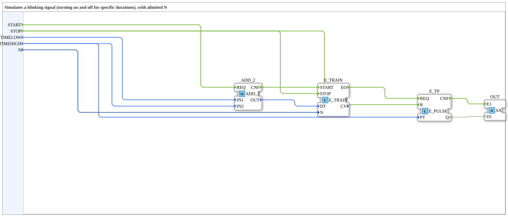

# AX_BLINK_TRAIN

* * * * * * * * * *

## Einleitung

Der AX_BLINK_TRAIN ist ein Funktionsblock, der ein Blinksignal mit begrenzter Anzahl N von Ereignissen (definierte Ein- und Ausschaltzeiten) über einen AX-Adapter ausgibt.

## Schnittstellenstruktur

### **Ereignis-Eingänge**

- **START** (Event): Startet die periodische Erzeugung der Ereignisse (mit TIMELOW, TIMEHIGH, N).
- **STOP** (Event): Stoppt die Erzeugung.

### **Daten-Eingänge**

- **TIMELOW** (TIME): Zeit, in der OUT FALSE ist.
- **TIMEHIGH** (TIME): Zeit, in der OUT TRUE ist.
- **N** (UINT): Anzahl der zu erzeugenden Ereignisse.

### **Adapter**

**Plugs (Ausgänge):**

- **OUT** (adapter::types::unidirectional::AX): Ausgangswert, beginnt mit FALSE und wechselt für die angegebenen High- und Low-Zeiten zwischen TRUE und FALSE.

## Funktionsweise

Nach `START` gibt der Baustein am Adapter OUT ein Blinksignal aus: Der Ausgang beginnt mit FALSE und ist jeweils für TIMEHIGH TRUE und für TIMELOW FALSE. Es werden N Ereignisse erzeugt; `STOP` beendet die Erzeugung.

## Technische Besonderheiten

- Verwendet unidirektionale Adapter.

## Zustandsübersicht

Zustandsbasiert.

## Anwendungsszenarien

Bahnübergänge, Warnsignale.

## ⚖️ Vergleich mit ähnlichen Bausteinen

- Keine direkte Standard-Entsprechung.

## 🛠️ Zugehörige Übungen

- [Uebung_035a3_AX](https://meisterschulen-am-ostbahnhof-munchen-docs.readthedocs.io/projects/4diac-exercises-docs/de/latest/Uebungen/test_AX/Uebungen_doc/Uebung_035a3_AX/)

## Fazit

Adapter-basierter Zug-Blink-Baustein.
