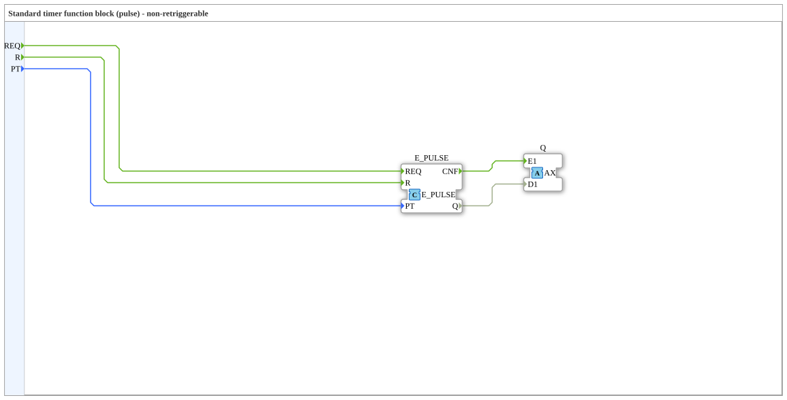

# AX_PULSE

* * * * * * * * * *

## Einleitung

**Wichtiger Hinweis: Dieser Baustein benötigt nur ein Ereignis (Event) und keine zyklischen Aufrufe. Er besitzt keinen Ausgang ET und zeigt die verstrichene Zeit nicht an.**

Der AX_PULSE ist ein Funktionsblock, der einen Impuls über einen AX-Adapter ausgibt.

## Schnittstellenstruktur

### **Ereignis-Eingänge**

- **REQ** (Event): Service-Anforderung (mit `PT`); löst den Impuls aus.
- **R** (Event): Reset.

### **Daten-Eingänge**

- **PT** (TIME): Impulsdauer.

### **Adapter**

**Plugs (Ausgänge):**

- **Q** (adapter::types::unidirectional::AX): Timer-Ausgang (AX-Adapter), liefert den Impuls.

## Funktionsweise

Bei REQ wird Q für die Dauer `PT` aktiv (nicht nachtriggerbar); R setzt den Impuls zurück. Intern wird ein `E_PULSE` verwendet, dessen `CNF`/`Q` auf den Adapter `Q` geführt werden.

## Technische Besonderheiten

- Verwendet unidirektionale Adapter.

## Zustandsübersicht

Impuls.

## Anwendungsszenarien

Signalisierung.

## ⚖️ Vergleich mit ähnlichen Bausteinen

- **E_PULSE**

## 🛠️ Zugehörige Übungen

- [Uebung_020h_AX](https://meisterschulen-am-ostbahnhof-munchen-docs.readthedocs.io/projects/4diac-exercises-docs/de/latest/Uebungen/test_AX/Uebungen_doc/Uebung_020h_AX/)
- [Uebung_020i_AX](https://meisterschulen-am-ostbahnhof-munchen-docs.readthedocs.io/projects/4diac-exercises-docs/de/latest/Uebungen/test_AX/Uebungen_doc/Uebung_020i_AX/)

## Fazit

Adapter-basierter Impuls-Baustein.
