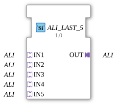

# ALI_LAST_5

## Einleitung

Der Funktionsblock `ALI_LAST_5` führt 5 gleichartige `LINT`-Adapter-Signale (**IN1** bis **IN5**) auf einen gemeinsamen Ausgang (**OUT**) zusammen, nach dem Prinzip **Last Writer Wins**: Der Socket, der zuletzt ein Ereignis gesendet hat, gewinnt, und sein Wert wird sofort an OUT durchgereicht. Es ist eine reine Arbitrierung nach zeitlicher Reihenfolge, keine Verknüpfung der Werte.

## Schnittstellenstruktur

### **Adapter**

**Eingangsadapter (Sockets):**

- **IN1**: LINT-Adapter (unidirectional)
- **IN2**: LINT-Adapter (unidirectional)
- **IN3**: LINT-Adapter (unidirectional)
- **IN4**: LINT-Adapter (unidirectional)
- **IN5**: LINT-Adapter (unidirectional)

**Ausgangsadapter (Plug):**

- **OUT**: LINT-Adapter (unidirectional), zusammengeführtes Signal

## Funktionsweise

Der Socket mit dem letzten Ereignis gewinnt. OUT übernimmt sofort dessen Wert und sendet das Adapter-Ereignis, auch wenn der Wert gleich bleibt. Es gibt keine feste Priorität, nur die zeitliche Reihenfolge.

## Technische Besonderheiten

- Generischer Funktionsblock ohne ECC (`GenericClassName` = `GEN_ALI_LAST`); das Verhalten ist in der Firmware (FORTE) umgesetzt, die Typbeschreibung enthält keinen Algorithmus.
- Schnittstelle: Sockets `IN1` bis `IN5`, Plug `OUT`.
- Alle Größen `ALI_LAST_2` bis `ALI_LAST_9` haben dieselbe Funktion und unterscheiden sich nur in der Zahl der Sockets.
- Die Bibliotheksversion bleibt 3.0.0. Voraussetzung ist eine neue FORTE- beziehungsweise `adapter_events`-ELF; sonst gilt `ALI_LAST_3` und höher als unbekannter Typ (Angabe aus der Entwicklung, nicht geprüft).
- Stand: Laut Entwicklung ist `AD_LAST_3` auf Hardware getestet (Trainer20, ESP32-S31); die übrigen Typen und Größen sind es nicht.

## Anwendungsszenarien

- Zusammenführen gleichwertiger Signalquellen zu einem nachgeschalteten Adapterpfad, zum Beispiel ein manueller und ein automatischer Sollwertgeber.
- Arbitrierung zwischen mehreren Bedienstellen, die denselben Wert schreiben dürfen.
- Vereinfachung von Netzwerken, die sonst `F_SEL`/`E_RS` inline verdrahten müssten.
