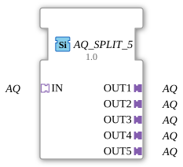

# AQ_SPLIT_5

* * * * * * * * * *

!!! warning "Noch nicht freigegeben"
    Der Baustein ist als Typ in der Bibliothek definiert (Stand 2026-11-13). Die zugehörige Firmware-Seite (C++ und ELF-Bibliotheken) ist noch nicht freigegeben. Bitte noch nicht als lauffähig voraussetzen.

## Einleitung

`AQ_SPLIT_5` verteilt **einen** AQ-Adapter auf 5 gleiche Adapter-Ausgänge. Der Baustein ist generisch (`GEN_AQ_SPLIT`).

## Schnittstellenstruktur

### **Ereignis-Eingänge**

Keine direkten Ereignisse.

### **Ereignis-Ausgänge**

Keine direkten Ereignisse.

### **Daten-Eingänge**

Keine direkten Daten.

### **Daten-Ausgänge**

Keine direkten Daten.

### **Adapter**

| Rolle | Name | Typ | Beschreibung |
| --- | --- | --- | --- |
| Socket | IN | adapter::types::unidirectional::AQ |  |
| Plug | OUT1 | adapter::types::unidirectional::AQ |  |
| Plug | OUT2 | adapter::types::unidirectional::AQ |  |
| Plug | OUT3 | adapter::types::unidirectional::AQ |  |
| Plug | OUT4 | adapter::types::unidirectional::AQ |  |
| Plug | OUT5 | adapter::types::unidirectional::AQ |  |

## Funktionsweise

Die Ausgänge werden **nur bei einer Wertänderung** aktualisiert, das Ereignis kommt nur bei tatsächlicher Änderung. Für die Variante ohne Änderungserkennung gibt es `AQ_SPLIT_5_UNGATED`.

## Technische Besonderheiten

- Generischer Baustein (`GenericClassName` = `GEN_AQ_SPLIT`), keine eigene Netzwerkdefinition im Typ.
- Die Implementierung liegt in der Firmware (C++), nicht im Typ.

## ⚖️ Vergleich mit ähnlichen Bausteinen

- Andere Ausgangszahl: [AQ_SPLIT_6](AQ_SPLIT_6.md), [AQ_SPLIT_7](AQ_SPLIT_7.md), [AQ_SPLIT_8](AQ_SPLIT_8.md), [AQ_SPLIT_9](AQ_SPLIT_9.md).
- Mit Änderungserkennung bzw. ohne: [AQ_SPLIT_5_UNGATED](AQ_SPLIT_5_UNGATED.md).
