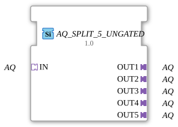

# AQ_SPLIT_5_UNGATED

* * * * * * * * * *

!!! warning "Noch nicht freigegeben"
    Der Baustein ist als Typ in der Bibliothek definiert (Stand 2026-11-13). Die zugehörige Firmware-Seite (C++ und ELF-Bibliotheken) ist noch nicht freigegeben. Bitte noch nicht als lauffähig voraussetzen.

## Einleitung

`AQ_SPLIT_5_UNGATED` verteilt **einen** AQ-Adapter auf 5 gleiche Adapter-Ausgänge. Der Baustein ist generisch (`GEN_AQ_SPLIT`).

## Schnittstellenstruktur

### **Ereignis-Eingänge**

Keine direkten Ereignisse.

### **Ereignis-Ausgänge**

Keine direkten Ereignisse.

### **Daten-Eingänge**

Keine direkten Daten.

### **Daten-Ausgänge**

Keine direkten Daten.

### **Adapter**

| Rolle | Name | Typ | Beschreibung |
| --- | --- | --- | --- |
| Socket | IN | adapter::types::unidirectional::AQ |  |
| Plug | OUT1 | adapter::types::unidirectional::AQ |  |
| Plug | OUT2 | adapter::types::unidirectional::AQ |  |
| Plug | OUT3 | adapter::types::unidirectional::AQ |  |
| Plug | OUT4 | adapter::types::unidirectional::AQ |  |
| Plug | OUT5 | adapter::types::unidirectional::AQ |  |

## Funktionsweise

Die Variante `_UNGATED` hat **keine Änderungserkennung**: Jedes eingehende Ereignis geht bedingungslos an alle 5 Ausgänge. Das ist für Verbraucher gedacht, die eine periodische Kadenz unabhängig von Wertänderungen brauchen, zum Beispiel Ableitungs- oder Frequenzberechnungen.

## Technische Besonderheiten

- Generischer Baustein (`GenericClassName` = `GEN_AQ_SPLIT`), keine eigene Netzwerkdefinition im Typ.
- Die Implementierung liegt in der Firmware (C++), nicht im Typ.

## ⚖️ Vergleich mit ähnlichen Bausteinen

- Andere Ausgangszahl: [AQ_SPLIT_6_UNGATED](AQ_SPLIT_6_UNGATED.md), [AQ_SPLIT_7_UNGATED](AQ_SPLIT_7_UNGATED.md), [AQ_SPLIT_8_UNGATED](AQ_SPLIT_8_UNGATED.md), [AQ_SPLIT_9_UNGATED](AQ_SPLIT_9_UNGATED.md).
- Mit Änderungserkennung bzw. ohne: [AQ_SPLIT_5](AQ_SPLIT_5.md).
