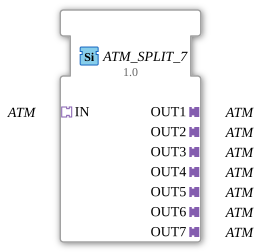

# ATM_SPLIT_7

* * * * * * * * * *

!!! warning "Noch nicht freigegeben"
    Der Baustein ist als Typ in der Bibliothek definiert (Stand 2026-11-13). Die zugehörige Firmware-Seite (C++ und ELF-Bibliotheken) ist noch nicht freigegeben. Bitte noch nicht als lauffähig voraussetzen.

## Einleitung

`ATM_SPLIT_7` verteilt **einen** ATM-Adapter auf 7 gleiche Adapter-Ausgänge. Der Baustein ist generisch (`GEN_ATM_SPLIT`).

## Schnittstellenstruktur

### **Ereignis-Eingänge**

Keine direkten Ereignisse.

### **Ereignis-Ausgänge**

Keine direkten Ereignisse.

### **Daten-Eingänge**

Keine direkten Daten.

### **Daten-Ausgänge**

Keine direkten Daten.

### **Adapter**

| Rolle | Name | Typ | Beschreibung |
| --- | --- | --- | --- |
| Socket | IN | adapter::types::unidirectional::ATM |  |
| Plug | OUT1 | adapter::types::unidirectional::ATM |  |
| Plug | OUT2 | adapter::types::unidirectional::ATM |  |
| Plug | OUT3 | adapter::types::unidirectional::ATM |  |
| Plug | OUT4 | adapter::types::unidirectional::ATM |  |
| Plug | OUT5 | adapter::types::unidirectional::ATM |  |
| Plug | OUT6 | adapter::types::unidirectional::ATM |  |
| Plug | OUT7 | adapter::types::unidirectional::ATM |  |

## Funktionsweise

Die Ausgänge werden **nur bei einer Wertänderung** aktualisiert, das Ereignis kommt nur bei tatsächlicher Änderung. Für die Variante ohne Änderungserkennung gibt es `ATM_SPLIT_7_UNGATED`.

## Technische Besonderheiten

- Generischer Baustein (`GenericClassName` = `GEN_ATM_SPLIT`), keine eigene Netzwerkdefinition im Typ.
- Die Implementierung liegt in der Firmware (C++), nicht im Typ.

## ⚖️ Vergleich mit ähnlichen Bausteinen

- Andere Ausgangszahl: [ATM_SPLIT_5](ATM_SPLIT_5.md), [ATM_SPLIT_6](ATM_SPLIT_6.md), [ATM_SPLIT_8](ATM_SPLIT_8.md), [ATM_SPLIT_9](ATM_SPLIT_9.md).
- Mit Änderungserkennung bzw. ohne: [ATM_SPLIT_7_UNGATED](ATM_SPLIT_7_UNGATED.md).
